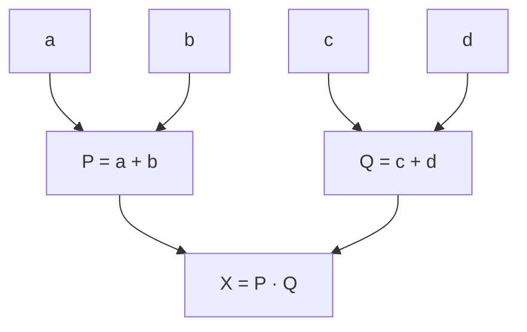

# Системы параллельной обработки данных: архитектуры, масштабируемость и эффективность алгоритмов

Конспект лекции от 8 октября 2026 года. Основание: текст лекции и изображения слайдов. Формулы восстановлены по изображениям. Теоретические оценки, практические требования преподавателя и уточнения к неоднозначным формулировкам вынесены в отдельные разделы.

## 1. Место лекции в курсе

Лекция завершает обсуждение аппаратных архитектур и переходит к оценке параллельных алгоритмов. Последовательность тем:

1. Физическая и виртуальная архитектуры вычислительной системы.
2. Переход от специальных процессоров к обычным многоядерным системам и кластерам.
3. Возможности OpenMP, MPI и PVM.
4. Области применения суперкомпьютеров и распределённых ресурсов.
5. Теоретические пределы ускорения: законы Амдала и Густафсона.
6. Масштабируемость программы и трудности параллельного программирования.
7. Граф алгоритма, ярусы и показатели эффективности.
8. Обычная и модифицированная каскадные схемы суммирования.
9. Требования к практическим работам, отчётам и защите.

Далее планируется кратко рассмотреть классификацию Флинна и перейти к MPI. В практических работах будут использоваться сети Петри.

## 2. Физическая и виртуальная архитектуры

### 2.1. Физическая архитектура

Физическая архитектура описывает реальные вычислительные узлы и соединения между ними. В примере с транспьютерами у каждого процессора есть четыре коммуникационных линка. Ручные коммутаторы позволяли менять соединения и получать разные конфигурации, например матрицу или дерево.

Выбор структуры связан с характером задачи:

- Для перемножения матриц естественно рассмотреть расположение процессоров в виде матрицы. Преподаватель подчёркивает, что это первая возможная идея, а не доказательство оптимальности такой структуры.
- Для раздачи исходных данных из нулевого процессора остальным процессорам естественно рассмотреть дерево.
- Для других алгоритмов могут быть удобны другие схемы обмена.

В рассматриваемой распределённой системе общей памяти между узлами нет; взаимодействие происходит через обмен сообщениями.

### 2.2. Виртуальная архитектура

Виртуальная архитектура задаёт логическую организацию процессов и их взаимодействий. Она позволяет выразить нужную алгоритму структуру поверх имеющейся аппаратной системы. Идея выбора матрицы, дерева или другой топологии сохраняется, хотя физически переставлять соединения не требуется.

Создание такой архитектуры через библиотеку скрывает детали реализации. Знание её устройства помогает понимать стоимость обменов, синхронизации и выбранной организации вычислений.

**Для лабораторных работ:** в предпоследней и последней работах потребуется создавать архитектуру, соответствующую задаче.

## 3. От специальных процессоров к стандартным системам

В изложении преподавателя процессоры нетрадиционной архитектуры широко применялись в конце 1980-х годов, в том числе в промышленности, а затем уступили место стандартным решениям с многоядерными процессорами. В речи названы ориентиры 1988–1989 и 2000–2004 годов; это историческая рамка лекции, а не точная датировка появления или полного исчезновения технологии.

Недостатки специальных решений:

- Нужно приобретать отдельные транспьютеры и систему на их основе.
- Требуются специальные средства программирования.
- Упоминаются Occam и PARIX, связанный с параллельным Unix.
- Решение оказывается привязано к определённой платформе, и переносимость ограничена.

Современный подход в рамках лекции: обычный многоядерный процессор, стандартный язык программирования, например C++ или Java, и дополнительные средства организации параллельных вычислений.

### 3.1. Упомянутые средства программирования

| Средство | Назначение и контекст лекции |
|---|---|
| OpenMP | Работа с параллельностью в системах с общей памятью; в обсуждении упоминаются потоки и семафоры. |
| MPI | Обмен сообщениями между процессами; основной инструмент дальнейшей части курса. |
| PVM — Parallel Virtual Machine | Объединение сетевых компьютеров в виртуальную параллельную вычислительную систему. |

В качестве примера PVM предлагается объединить около двадцати машин учебного класса, а затем несколько классов университета. В лекции отмечается, что эта тема сейчас менее распространена.

Преподаватель использует для MPI слово «библиотека», хотя в названии MPI речь об интерфейсе. Важно различать сам интерфейс и его конкретную реализацию.

### 3.2. Какие задачи должны решать средства параллельного программирования

- Организация параллельных процессов.
- Объединение процессов в группы и изменение их организации.
- Создание связей и выполнение отправки и приёма: send, receive.
- Схемы взаимодействия «один — всем» и «все — одному».
- Передача данных между процессами.
- Организация синхронного взаимодействия.
- Распределение вычислений по доступным процессорам.

Для специалиста по параллельным вычислениям важны и алгоритмы, и архитектура, и механизмы взаимодействия процессов.

## 4. Многоядерные узлы, SMP и кластеры

Многоядерный компьютер уже является параллельной системой. Внутри узла есть несколько вычислительных ядер, общая память и уровни кэширования.

**SMP — Symmetric Multiprocessing:** симметричная многопроцессорная обработка. В контексте лекции это система, в которой процессоры или ядра работают с общей памятью.

Объединение таких узлов через сеть образует кластер:

- Внутри узла используется общая память.
- Между узлами данные передаются по сети.
- Узлы и процессы должны быть идентифицируемы, чтобы адресовать обмен.
- Каждый узел сам может быть параллельным компьютером.
- Увеличивать систему можно добавлением новых узлов.

В примерах обсуждаются платы с несколькими ядрами и плата с двумя процессорами, каждый из которых многоядерный. Точные числа ядер не являются основой дальнейших расчётов.

**Различие для последующих работ:** программный процесс и физическое ядро — разные сущности. Увеличение числа процессов не гарантирует появления новых физических вычислительных ресурсов. Когда процессов больше, чем доступных ядер, возникают разделение времени и расходы планирования.

## 5. Где используются большие вычислительные мощности

### 5.1. Основные классы задач

- **Grand Challenge — задачи большого вызова:** крупные научные и инженерные задачи в физике, нанотехнологиях, аэронавтике, биологии и других областях. В лекции говорится об обновляемых перечнях таких задач.
- Поисковые системы и обработка больших массивов данных.
- Транзакции в реальном времени.
- Data mining — анализ данных.
- Искусственный интеллект и машинное обучение.
- Цифровые двойники и промышленное моделирование.
- **Real-time:** получение ответа в заданный срок. Здесь может быть важнее уложиться в ограничение по времени, чем просто получить максимально возможное ускорение.

Графические процессоры подходят для большого числа однотипных операций над массивами. Использование GPU не ограничивается обработкой графики.

### 5.2. FLOPS и масштабы производительности

**FLOPS — Floating-point Operations Per Second:** число операций с плавающей точкой в секунду.

| Единица | Число FLOPS |
|---|---:|
| Терафлопс | $10^{12}$ |
| Петафлопс | $10^{15}$ |
| Эксафлопс | $10^{18}$ |
| Зеттафлопс | $10^{21}$ |
| Йоттафлопс | $10^{24}$ |

В лекции обсуждается пиковая производительность. Её следует отличать от производительности конкретной программы: последняя зависит от алгоритма, обменов, памяти и загрузки процессоров.

Цвета на показанной преподавателем шкале обозначали освоенные уровни, прорывные направления и дальние исследовательские ориентиры. Текст не позволяет однозначно привязать все цвета к конкретным единицам. Упоминается развитие нанотехнологий и техпроцессов порядка 4–6 нм как пример прогресса аппаратуры.

### 5.3. Примеры из лекции

Приведённые ниже сведения относятся к материалам лектора, главным образом за 2024 год. Их актуальность на дату лекции отдельно не проверялась.

| Пример | Что важно сохранить |
|---|---|
| Суперкомпьютеры Яндекса | В лекции названы места 42, 69 и 79 в мировом списке TOP500 за рассматриваемый период; используются графические процессоры NVIDIA. |
| Научный консорциум, название в тексте — High Performance Computer | Около 900 серверов в шести суперкомпьютерных центрах; ресурсы объединены, ими пользуются порядка 240 организаций. Точное название по приложенным слайдам не уточняется. |
| K2 Neurotech | Пример объединения суперкомпьютерных кластеров и предоставления вычислений как сервиса. Выделяются научные исследования, ИИ и машинное обучение, промышленное моделирование. |

**Грид:** объединение распределённых вычислительных ресурсов для совместного использования. Ресурсы могут находиться в разных центрах. В лекции слово переводится как «сетка».

### 5.4. Цифровые двойники

Цифровой двойник — модель объекта, которая позволяет изучать его поведение и состояние вычислительными средствами.

На примере самолёта:

- Моделируются отдельные блоки, двигатели и другие элементы.
- Из моделей компонентов собирается модель самолёта.
- Признаки неисправности могут использоваться для диагностики.
- Создание достаточно подробной модели требует больших вычислительных ресурсов.

В лекции также упоминается перспектива цифровых двойников человека для моделирования заболеваний и диагностики. Это приведено как направление развития, а не как подтверждённая доступная каждому технология.

Пример аэродинамики:

- В ЦАГИ и других организациях используется аэродинамическая труба.
- Она позволяет изучать обтекание модели самолёта воздухом.
- Физическое испытание требует больших помещений, мощных вентиляторов и энергии.
- Полномасштабное моделирование большого самолёта физическими средствами затруднено, поэтому рассматриваются отдельные элементы.
- Численное моделирование позволяет исследовать процессы в цифровом виде.

В качестве вычислительной системы упоминается СКИФ в МГУ; преподаватель связывает его с историческим присутствием в TOP500 до 2011 года. Название и датировка сохраняются как сведения из речи.

**Ключевой вопрос:** насколько цифровая модель соответствует физическому объекту? Адекватность модели нужно проверять; наличие мощного суперкомпьютера само по себе её не гарантирует.

## 6. Модель, в которой оцениваются алгоритмы

Дальнейшие расчёты сначала рассматривают алгоритм независимо от конкретной аппаратуры. Они дают первичную оценку потенциального параллелизма.

Принятые упрощения:

- Для подсчёта времени элементарная операция занимает одну условную единицу.
- Время передачи данных в учебных примерах не учитывается.
- Реальные задержки памяти, сети и синхронизации не включены.
- Процессоры рассматриваются как одинаковые вычислительные ресурсы.
- Ярусы графа используются как последовательность параллельных шагов.

Для реальной реализации потребуются дополнительные измерения. Один и тот же алгоритм может вести себя по-разному на разных архитектурах.

Время операций нельзя считать нулевым при вычислении ускорения: иначе отношение времён теряет смысл. В расчётах лекции используется именно единичная стоимость операций.

## 7. Основные показатели параллельного алгоритма

### 7.1. Обозначения

| Обозначение | Значение |
|---|---|
| $n$ | Размер или параметр сложности задачи, например число входных значений. |
| $p$ | Число используемых процессоров в вычислительной модели. |
| $T_1(n)$ | Время последовательного выполнения выбранного алгоритма сравнения. |
| $T_p(n)$ | Время параллельного выполнения на $p$ процессорах. |
| $S_p(n)$ | Ускорение. |
| $E_p(n)$ | Эффективность использования процессоров. |
| $C_p(n)$ | Стоимость вычислений, выраженная в процессорном времени. |
| $T_0(n,p)$ | Накладные расходы относительно выбранного последовательного выполнения. |

### 7.2. Ускорение

$$
S_p(n)=\frac{T_1(n)}{T_p(n)}.
$$

Показывает, во сколько раз параллельное выполнение быстрее выбранного последовательного варианта.

- $S_p>1$: время уменьшилось.
- $S_p=1$: время совпало.
- $S_p<1$: параллельный вариант медленнее.
- Идеальная линейная зависимость в рассматриваемой модели: $S_p=p$.

На графике первого изображения зелёная линия показывает идеальное ускорение, синяя — замедление прироста и насыщение, красная — ухудшение после некоторого числа процессоров.

### 7.3. Эффективность

$$
E_p(n)=\frac{T_1(n)}{pT_p(n)}=\frac{S_p(n)}p.
$$

При идеальном линейном ускорении $E_p=1$. В простой модели равных операций показатель можно интерпретировать как среднюю полезную загрузку выделенных процессоров. Это среднее значение: отдельные процессоры могут быть загружены неодинаково.

**Уточнение:** эффективность безразмерна. При произвольном выборе последовательного алгоритма она не равна измеренной загрузке CPU; прежде всего это отношение времени выбранного эталонного выполнения к суммарному выделенному процессорному времени.

Для хорошей масштабируемости желательно сохранять эффективность выше некоторой положительной границы при согласованном росте размера задачи и ресурсов. Формулировка первого слайда об ограничении «ускорения» неоднозначна; в последующих примерах анализируется именно падение или сохранение эффективности.

### 7.4. Стоимость и накладные расходы

$$
C_p=pT_p,
\qquad
T_0=pT_p-T_1=C_p-T_1.
$$

Стоимость — суммарное время выделенных процессоров. Если время измеряется в секундах, единица стоимости — процессор-секунда. Денежная стоимость напрямую этой формулой не задаётся.

В накладные расходы могут входить простои, организация взаимодействия, обмены и синхронизация. В идеальных графовых примерах они отражают прежде всего неиспользованное процессорное время относительно выбранного эталона.

Следствие формул:

$$
E_p=\frac{T_1}{T_1+T_0}.
$$

Поэтому рост накладных расходов при неизменном $T_1$ уменьшает эффективность.

### 7.5. Общие зависимости

- При фиксированной сложности задачи увеличение числа процессоров обычно постепенно снижает эффективность.
- При фиксированном числе процессоров увеличение объёма полезной работы может улучшать эффективность.
- Чтобы сохранять некоторый уровень эффективности при росте числа процессоров, часто требуется увеличивать размер задачи.
- Ускорение, эффективность и стоимость характеризуют разные стороны вычислений. Их улучшение не всегда происходит одновременно.

## 8. Закон Амдала

### 8.1. Постановка

Рассматривается задача фиксированного объёма. Увеличивается число процессоров, а цель — уменьшить время выполнения.

Закон связан с Джином Амдалом; в лекции указан 1967 год и работа автора в IBM.

Пусть $\alpha$ — доля последовательной части во времени последовательного выполнения. Тогда параллельная доля равна $1-\alpha$.

$$
T_p=T_1\left(\alpha+\frac{1-\alpha}{p}\right),
\qquad
S_p=\frac{1}{\alpha+\frac{1-\alpha}{p}}.
$$

Это идеализированная формула **без дополнительных расходов на синхронизацию и обмен**. Последовательная часть остаётся последовательной, а параллельная делится между $p$ процессорами.

### 8.2. Выводы

- Чем больше $\alpha$, тем меньше достижимое ускорение.
- При $\alpha>0$ существует предел:

$$
\lim_{p\to\infty}S_p=\frac1\alpha.
$$

- При $\alpha=0$ идеальная модель даёт $S_p=p$; постоянного верхнего предела по этой формуле нет.
- Увеличение числа процессоров после приближения к пределу даёт всё меньший прирост.
- Реальные обмены, синхронизация и дисбаланс нагрузки могут дополнительно ухудшить результат.

На слайде 210725 в пункте об ограничении сверху напечатано $\alpha=0$. По самой формуле этот пункт относится к $\alpha>0$.

### 8.3. Что показывает график

На изображении показаны четыре доли параллельной части:

| Параллельная доля | Последовательная доля $\alpha$ | Предел ускорения |
|---:|---:|---:|
| 50% | 0,50 | 2 |
| 75% | 0,25 | 4 |
| 90% | 0,10 | 10 |
| 95% | 0,05 | 20 |

Число процессоров по горизонтальной оси растёт до 65 536. Для 95% параллельного кода кривая приблизилась к пределу примерно в области тысячи процессоров. Для 50% параллельного кода насыщение заметно намного раньше; в речи приводится ориентир 32 процессора.

Это плавное приближение, а не строгая точка, после которой прирост математически равен нулю. Например, при $\alpha=0{,}5$ и $p=32$ ускорение равно $64/33\approx1{,}94$, а предел равен 2.

## 9. Закон Густафсона

### 9.1. Постановка

Время выполнения остаётся приемлемым или примерно постоянным, а при увеличении числа процессоров увеличивается объём решаемой задачи.

На слайде указан **John Leroy Gustafson**, учёный и предприниматель, известный работами в области **High Performance Computing — HPC**, и 1988 год.

Главная идея: параллельные ресурсы позволяют решать более крупную задачу за тот же промежуток времени. Это называется масштабированным ускорением — **scaled speedup**.

### 9.2. Формула

На слайде:

$$
S_N=N+(1-N)s=N-(N-1)s.
$$

- $N$ — число процессоров; далее можно обозначать его как $p$.
- $s$ — доля последовательной части во времени параллельного выполнения масштабированной задачи.

При нормированном параллельном времени 1 последовательная часть занимает $s$, параллельная — $1-s$. Последовательное выполнение той же увеличенной задачи потребовало бы $s+p(1-s)$ единиц времени.

Доля $s$ здесь нормируется иначе, чем $\alpha$ в законе Амдала. Эти обозначения нельзя автоматически считать одним и тем же числом для разных постановок задачи.

### 9.3. Идея масштабирования задачи

В материалах отмечается:

- При изменении ресурсов на практике часто меняется и объём данных.
- Увеличение размера задачи может увеличивать долю параллельной работы.
- В рассматриваемой модели последовательная работа увеличивается слабее или остаётся примерно постоянной.
- Для маленьких задач, например очень малой матрицы, расходы организации параллельного исполнения могут превысить выигрыш.

Утверждение слайда, что фиксированные задачи обычно не запускают на разном числе процессоров, описывает выбранную практическую постановку. В лабораторных измерениях курса такое сравнение как раз понадобится.

### 9.4. Сопоставление законов

| Вопрос | Амдал | Густафсон |
|---|---|---|
| Что фиксируется? | Объём задачи. | Приемлемое время выполнения. |
| Что меняется? | Число процессоров. | Число процессоров и размер задачи. |
| Цель | Решить ту же задачу быстрее. | Решить более крупную задачу за то же время. |
| Ускорение | $1/(\alpha+(1-\alpha)/p)$. | $p-(p-1)s$. |
| Основное ограничение | Непараллельная часть фиксированной задачи. | Размер последовательной части масштабируемой задачи. |

На изображении для $p=2,8,16,128$ показаны зависимости ускорения от доли последовательных вычислений. Слева, для Амдала, кривые быстро снижаются; справа, для Густафсона, зависимости линейны. Законы описывают разные условия изменения задачи.

## 10. Сильное и слабое масштабирование

| Вид | Что сохраняется | Что увеличивается | Идеальная цель |
|---|---|---|---|
| Сильное — strong scaling | Общий размер задачи. | Число процессоров. | Уменьшать время решения. |
| Слабое — weak scaling | Примерно одинаковый объём работы на процессор. | Число процессоров и общий размер задачи. | Сохранять время решения. |

В лекции сильное масштабирование связывается с постановкой Амдала, слабое — с увеличением задачи в духе Густафсона. Слабое масштабирование и масштабированное ускорение связаны, но являются разными характеристиками эксперимента.

## 11. Масштабируемая программа

**Требование курса:** программу нужно один раз написать и отладить так, чтобы она могла работать на разных количествах процессов без ручной переделки алгоритма под каждый запуск.

Программа, которая работает только на заранее выбранных шести или восьми процессорах, не соответствует этому требованию.

Что нужно предусмотреть:

- Получение количества запущенных процессов и их идентификаторов.
- Распределение работы в зависимости от этого количества.
- Корректную организацию обменов при разных размерах группы процессов.
- Учет накладных расходов.

Речь идёт об отсутствии необходимости вручную переписывать программу для нового числа процессов. Это не запрещает передавать разные входные данные или параметры при запуске.

### 11.1. Как измерять в практических работах

1. Запустить масштабируемую программу на одном процессоре или процессе согласно условиям работы и получить время $T_1$.
2. Запустить её на нескольких количествах процессов и измерить $T_p$.
3. Посчитать $S_p=T_1/T_p$.
4. Построить график ускорения от числа процессов.
5. При необходимости дополнительно рассмотреть эффективность $E_p=S_p/p$.

Основной интерес преподавателя — ускорение. Для практических работ запуск той же программы на одном процессе принимается как последовательная база сравнения. Отдельную оптимизированную последовательную реализацию делать необязательно.

Для общего анализа алгоритмов база сравнения требует отдельного выбора: слабый последовательный вариант способен завысить заявленное ускорение. Пример с прямоугольником подробно показывает это ниже.

## 12. Трудности параллельного программирования

### 12.1. Управление процессами и обменами

- Нужно управлять множеством одновременно работающих процессов.
- Нужно определить, кто, кому, что и когда передаёт.
- Нужно сохранять сбалансированную загрузку вычислительных узлов.
- Следует минимизировать ожидание одного процесса другим.
- Иногда выгоднее выполнить дополнительные локальные вычисления, чем организовывать передачу данных.

### 12.2. Тупиковые ситуации

**Дедлок — deadlock:** ситуация, при которой необходимые участники вычисления не могут продолжить выполнение из-за взаимных ожиданий.

В параллельной программе может заблокироваться одна ветвь, пока другие продолжают работать. Поэтому отсутствие полной остановки ещё не означает, что все части программы выполняются правильно.

### 12.3. Динамический характер ошибок

Задержки зависят от порядка выполнения, нагрузки и других обстоятельств. От запуска к запуску они меняются. Поэтому один запуск может пройти успешно, а следующий — проявить ошибку.

Один успешный запуск недостаточен для уверенности в корректности взаимодействий.

### 12.4. Детерминизм и допустимая недетерминированность

В обсуждении детерминизм объясняется как получение одного и того же результата при одних и тех же исходных данных и условиях.

В параллельных вычислениях порядок действий может меняться, а при определённой постановке задачи допустимы разные результаты. Преподаватель предупреждает: в первой лабораторной несколько запусков могут дать разные результаты, и это будет соответствовать заданию.

**Уточнение терминов:** идемпотентность — другое свойство: повторное применение операции не меняет результат после первого применения, например $f(f(x))=f(x)$. Детерминизм и идемпотентность не являются синонимами.

Допустимость разных результатов определяется условиями задачи. Сама по себе параллельность не оправдывает произвольные ошибочные результаты.

## 13. Граф алгоритма и ярусы

### 13.1. Определение по слайду

**Граф алгоритма $G(V,E)$** — ориентированный граф:

- Вершины представляют операции алгоритма.
- Дуга $(u,v)$ означает, что операция $v$ использует результат операции $u$.
- На рисунках также показаны исходные данные; их наличие не считается отдельной арифметической операцией.

В рассматриваемых примерах графы ациклические. Независимые операции можно выполнять параллельно, зависимая операция ждёт необходимые результаты.

Простейший пример:

$$
X=(a+b)(c+d).
$$

Сначала независимо выполняются $P=a+b$ и $Q=c+d$, затем вычисляется $X=P\cdot Q$.

При единичной стоимости операций здесь три арифметические операции и два параллельных шага. Это непосредственный подсчёт по изображению.

### 13.2. Ярус

**Ярус** — шаг или итерация параллельного алгоритма. Операции одного яруса могут выполняться одновременно после получения результатов предыдущих необходимых вычислений.

Различаются:

- **Общее число операций:** сколько работы необходимо сделать суммарно.
- **Число ярусов:** сколько последовательных параллельных шагов остаётся.
- **Ширина яруса:** сколько операций на нём можно выполнять одновременно.
- **Максимальная ширина:** сколько процессоров требуется, чтобы выполнить каждый ярус полностью параллельно в принятой схеме.

Число процессоров определяется самой широкой параллельной частью, а время в простой ярусной модели — числом вычислительных ярусов. Это разные числа.

**Важная граница:** «нужно четыре процессора» в подобном примере означает необходимость четырёх процессоров для одновременного выполнения четырёх операций. На меньшем числе процессоров алгоритм тоже можно выполнить, но часть операций придётся выполнять последовательно.

### 13.3. Граф алгоритма и сети Петри

Граф алгоритма вводится как простая модель для объяснения зависимостей и оценки параллелизма. Далее в практических работах будут использоваться сети Петри. Их устройство в этой лекции подробно не рассматривается, но строить их для отчётов потребуется.

В лекции упоминаются публикации 1989 и 2002 годов. На изображении указаны Bertsekas and Tsitsiklis (1989), Воеводин В.В. и Воеводин Вл.В. (2002). Эти ссылки относятся к обсуждаемым алгоритмическим материалам; из них не следует, что ориентированные графы алгоритмов вообще впервые появились в 1989 году.

## 14. Площадь прямоугольника: выбор алгоритма и базы сравнения

Исходные данные — координаты противоположных углов $(x_1,y_1)$ и $(x_2,y_2)$. На слайдах рассматривается формула:

$$
A=(x_2-x_1)(y_2-y_1)
 =x_2y_2-x_2y_1-x_1y_2+x_1y_1.
$$

Буква $A$ здесь обозначает площадь, чтобы не путать её с ускорением $S_p$. Для указанной формулы предполагается согласованный порядок координат; геометрическая площадь при произвольном порядке определяется модулем произведения разностей.

### 14.1. Развёрнутая формула: четыре процессора

Граф на изображениях:

| Ярус | Операции | Число одновременно выполняемых операций |
|---|---|---:|
| 1 | $x_2y_2$, $x_2y_1$, $x_1y_2$, $x_1y_1$ | 4 |
| 2 | $L=x_2y_2-x_2y_1$, $R=x_1y_2-x_1y_1$ | 2 |
| 3 | $A=L-R$ | 1 |

При единичной стоимости всех арифметических операций:

$$
p=4,\quad T_1^{\text{развёрнутый}}=7,\quad T_4=3.
$$

Расчёт на слайде относительно последовательного выполнения **той же развёрнутой формулы**:

$$
S_4=\frac73\approx2{,}33,
\qquad
E_4=\frac{7}{3\cdot4}=\frac7{12}\approx0{,}583.
$$

$$
C_4=4\cdot3=12,
\qquad
T_0=12-7=5.
$$

Последний показатель непосредственно следует из формулы накладных расходов. Процессоры загружены неравномерно: на первом ярусе заняты четыре, на втором два, на третьем один.

На изображении запись `7/3*4 = 7/12` оформлена неоднозначно. Правильный знаменатель для эффективности — $3\cdot4$.

### 14.2. Факторизованная формула: два процессора

Можно вычислить площадь непосредственно:

1. Параллельно вычислить $d_x=x_2-x_1$ и $d_y=y_2-y_1$.
2. Вычислить $A=d_xd_y$.

Получаем:

$$
p=2,\quad T_1^{\text{факторизованный}}=3,\quad T_2=2.
$$

Следствия при том же условии единичных операций:

$$
S_2=\frac32=1{,}5,
\qquad
E_2=\frac{3}{2\cdot2}=\frac34=0{,}75,
$$

$$
C_2=4,\qquad T_0=4-3=1.
$$

Здесь меньше процессоров, меньше операций и меньше время параллельного выполнения.

### 14.3. Почему ускорение может ввести в заблуждение

Сравнивать значения $7/3$ и $3/2$ напрямую как показатель превосходства алгоритма нельзя: в числителях разные последовательные базы. На слайде специально подчёркивается необходимость сравнения с **лучшим последовательным алгоритмом**.

Если в обоих вариантах взять доступную более короткую последовательную формулу с $T_1=3$, сравнение будет таким:

| Параллельный вариант | $p$ | $T_p$ | $S_p$ при общем $T_1=3$ | $E_p$ | $C_p$ |
|---|---:|---:|---:|---:|---:|
| Развёрнутая формула | 4 | 3 | 1 | 0,25 | 12 |
| Разности и произведение | 2 | 2 | 1,5 | 0,75 | 4 |

**Вывод:** более широкий граф не гарантирует лучшего решения. Выбор последовательного эталона влияет на заявленное ускорение. Для лабораторных допускается эталон, установленный преподавателем; для самостоятельного анализа его нужно указывать явно.

## 15. Пример с рабочими и комнатами: дисбаланс нагрузки

### 15.1. Пять одинаковых комнат

Условия:

- Пять рабочих.
- Пять комнат одинаковой площади.
- Производительность рабочих одинакова.
- Каждый рабочий красит одну комнату.
- Одна комната требует одной условной единицы времени.

Последовательно потребовалось бы пять единиц, параллельно — одна:

$$
T_1=5,\quad T_5=1,\quad S_5=5,\quad E_5=1.
$$

### 15.2. Одна комната вдвое больше

Общий объём работы теперь равен шести единицам, а параллельное выполнение завершается за две, потому что один рабочий красит большую комнату:

$$
T_1=6,\quad T_5=2,\quad S_5=3,\quad E_5=\frac35=0{,}6.
$$

Четыре рабочих заканчивают через одну единицу времени и затем ждут пятого. Вторая половина выполнения загружает только одного рабочего.

В лекции этот же результат получают, подставляя $\alpha=1/6$ в закон Амдала:

$$
S_5=\frac{1}{1/6+(5/6)/5}=3.
$$

**Уточнение:** численно расчёт совпадает, но в описанной ситуации комнаты независимы. Проблема состоит в неравномерном распределении работы, а не в обязательной последовательной зависимости между комнатами. Поэтому $1/6$ здесь следует понимать как принятую преподавателем модель примера, а не как автоматически установленную долю последовательного кода.

### 15.3. Предложенная проверка: десять комнат

Преподаватель предлагает аналогичный пример с десятью комнатами. Если рабочих десять, одна комната требует две единицы времени, остальные девять — по одной, то непосредственный расчёт даёт:

$$
T_1=11,\quad T_{10}=2,\quad S_{10}=\frac{11}{2}=5{,}5,
\quad E_{10}=0{,}55.
$$

Это расчёт для предложенной проверки, а не число, прочитанное с приложенного изображения.

**Главный смысл примера:** время всего параллельного выполнения определяется последним закончившим участником. Балансировка нагрузки — самостоятельное условие эффективной параллельности.

## 16. Последовательное суммирование

Задача:

$$
R=x_1+x_2+\ldots+x_n.
$$

При обычном накоплении суммы каждое следующее сложение использует предыдущую частичную сумму. На каждом ярусе графа находится только одна новая операция сложения.

$$
K_{\text{посл}}=n-1,\qquad T_1=n-1.
$$

Просто назначить больше процессоров такому графу недостаточно: зависимости останутся. Требуется изменить вычислительную схему.

В обсуждении предлагается, например, считать с разных концов массива. Преподаватель связывает эту идею с каскадной схемой, но предлагает сразу организовать попарное объединение всех значений.

В исходном примере все значения доступны заранее и не зависят друг от друга. Это позволяет изменить порядок объединения.

## 17. Обычная каскадная схема суммирования

### 17.1. Организация

Для удобства предполагается:

$$
n=2^k.
$$

На каждом шаге значения разбиваются на пары, пары суммируются, затем таким же образом суммируются полученные результаты.

| Ярус | Число сложений |
|---|---:|
| 1 | $n/2$ |
| 2 | $n/4$ |
| 3 | $n/8$ |
| Последний | 1 |

При произвольном $n$ могут появляться непарные элементы. Преподаватель отмечает, что это не принципиальная сложность; степень двойки выбрана для чистоты изложения.

### 17.2. Работа, время и процессоры

Общее количество арифметических операций:

$$
K_{\text{посл}}=\frac n2+\frac n4+\ldots+1=n-1.
$$

Количество ярусов:

$$
K_{\text{пар}}=k=\log_2n.
$$

Здесь обозначение $K_{\text{пар}}$ на слайде означает число **параллельных шагов**, а не суммарное количество арифметических операций.

Для выполнения самого широкого яруса одновременно:

$$
p=\frac n2.
$$

В единичной модели:

$$
T_1=n-1,\qquad T_p=\log_2n.
$$

### 17.3. Ускорение и эффективность

$$
S_p=\frac{n-1}{\log_2n},
$$

$$
E_p=\frac{n-1}{(n/2)\log_2n}
=\frac{2(n-1)}{n\log_2n}
\approx\frac2{\log_2n}.
$$

При $n\to\infty$:

$$
\log_2n\to\infty,
\qquad E_p\to0.
$$

Ускорение растёт, но эффективность выделенных процессоров снижается, потому что их число растёт как $n/2$, а поздние ярусы используют всё меньшую часть этих ресурсов.

Следствия для стоимости:

$$
C_p=\frac n2\log_2n,
\qquad
T_0=\frac n2\log_2n-(n-1).
$$

### 17.4. Пример при шестнадцати значениях

$$
n=16,\quad p=8,\quad T_1=15,\quad T_p=4.
$$

$$
S_p=\frac{15}{4}=3{,}75,
\qquad E_p=\frac{15}{32}=0{,}46875.
$$

По ярусам заняты 8, 4, 2 и 1 процессор. Суммарно выполняется 15 полезных операций, а выделяется $8\cdot4=32$ процессорные единицы времени.

### 17.5. Ограничение вывода

Падение эффективности здесь показано для конкретного выбора $p=n/2$, обеспечивающего максимальную одновременность первого яруса. Это не утверждение, что всякое увеличение числа суммируемых элементов при любом фиксированном $p$ обязательно ухудшает эффективность.

Суммирование в дерево представляет собой свёртку, или редукцию, набора значений. Слово «редукция» в расшифровке дискуссии употреблено неоднозначно; из этой реплики не следует запрет такого определения схемы.

Для переноса алгоритма на реальные числовые типы нужно отдельно учитывать свойства операции: перестановка скобок может менять результат сложения чисел с плавающей точкой. В учебных схемах лекции такой эффект не рассматривается.

## 18. Модифицированная каскадная схема

### 18.1. Зачем она вводится

Цель — увеличить полезную загрузку процессоров и получить эффективность, которая при росте задачи не стремится к нулю.

Схема состоит из двух этапов: последовательное суммирование внутри независимых групп и каскадное объединение результатов групп.

### 18.2. Первый этап

Размер группы:

$$
m=\log_2n.
$$

Количество групп:

$$
g=\frac{n}{\log_2n}.
$$

В каждой группе сумма вычисляется последовательно, но разные группы выполняются параллельно.

$$
p_1=g=\frac{n}{\log_2n},
\qquad
T^{(1)}=m-1=\log_2n-1.
$$

Важно различать **число групп** $n/\log_2n$ и **число элементов в группе** $\log_2n$.

### 18.3. Второй этап

Теперь есть $g$ частичных сумм. К ним применяется обычная каскадная схема:

$$
p_2=\frac g2=\frac{n}{2\log_2n},
\qquad
T^{(2)}=\log_2g
=\log_2\left(\frac{n}{\log_2n}\right).
$$

Число процессоров для всей программы берётся по более требовательному этапу:

$$
p=\max(p_1,p_2)=\frac{n}{\log_2n}.
$$

### 18.4. Время и его верхняя оценка

На изображении сначала записано время:

$$
T_p=\log_2n-1+
\log_2\left(\frac{n}{\log_2n}\right)
\le2\log_2n.
$$

Для последующего сравнения слайды используют упрощённую верхнюю оценку:

$$
\widehat T_p=2\log_2n.
$$

По этой оценке:

$$
\widehat S_p=\frac{n-1}{2\log_2n},
$$

$$
\widehat E_p=
\frac{n-1}{(n/\log_2n)\,2\log_2n}
=\frac{n-1}{2n}.
$$

$$
\lim_{n\to\infty}\widehat E_p=\frac12.
$$

Поскольку время заменено верхней оценкой, вычисленные таким способом ускорение и эффективность являются нижними оценками в принятой идеальной модели.

### 18.5. Связь с обычной каскадной схемой

| Показатель | Обычная каскадная схема | Модифицированная схема: оценка на слайдах |
|---|---|---|
| Последовательное время | $n-1$ | $n-1$ |
| Процессоры | $n/2$ | $n/\log_2n$ |
| Параллельное время | $\log_2n$ | $2\log_2n$ — верхняя оценка |
| Ускорение | $(n-1)/\log_2n$ | $(n-1)/(2\log_2n)$ — нижняя оценка |
| Эффективность | $2(n-1)/(n\log_2n)$ | $(n-1)/(2n)$ — нижняя оценка |
| Асимптотическая эффективность | Стремится к нулю. | Оценка стремится к 0,5. |

Вывод лекции: удаётся сохранить ненулевую эффективность, но в использованной оценке ускорение становится вдвое меньше.

**Точность вывода:** буквальное «в два раза» относится к сравнению упрощённых формул. Если использовать исходное выражение времени, то:

$$
T_p=2\log_2n-\log_2(\log_2n)-1.
$$

Для конечного $n$ это меньше $2\log_2n$. Отношение времени модифицированной схемы ко времени обычной стремится к 2, но не обязано равняться 2 в конкретном небольшом примере.

### 18.6. Пример при шестнадцати значениях

$$
n=16,\quad m=4,\quad g=4.
$$

Первый этап:

- Четыре группы по четыре числа.
- Четыре процессора.
- Внутри каждой группы три последовательных сложения.
- Время этапа — 3.

Второй этап:

- Четыре частичные суммы.
- На первом ярусе два сложения, на втором одно.
- Время этапа — 2.

Следовательно, фактическое время **в этой единичной модели** равно $T_p=3+2=5$, а верхняя оценка слайда равна $2\log_2 16=8$.

| Вариант расчёта при $n=16$ | $p$ | $T_p$ | $S_p$ | $E_p$ |
|---|---:|---:|---:|---:|
| Обычная каскадная схема | 8 | 4 | 3,75 | 0,46875 |
| Модифицированная, по исходной формуле времени | 4 | 5 | 3 | 0,75 |
| Модифицированная, по верхней оценке слайда | 4 | 8 | 1,875 | 0,46875 |

Этот расчёт показывает различие между временем схемы и его грубой оценкой.

### 18.7. Работа и стоимость

Суммарная полезная работа остаётся равной $n-1$. Действительно:

$$
g(m-1)+(g-1)=gm-1=n-1.
$$

Для упрощённой оценки времени:

$$
\widehat C_p=p\widehat T_p=2n,
\qquad
\widehat T_0=2n-(n-1)=n+1.
$$

Это следствия формул слайдов. При исходном, меньшем времени стоимость и накладные расходы также будут меньше этих оценок.

### 18.8. Условия применения формул

Формулы предполагают удобное разбиение на равные группы. Условие $n=2^k$ само по себе не гарантирует, что $n/\log_2n$ — целое число и степень двойки.

При реальной реализации потребуются обработка неполных групп, округления и перенос непарного результата на следующий уровень. Для учебных вычислений в лекции выбираются удобные случаи, например $n=16$ и $n=256$.

Обе каскадные схемы в лекции оцениваются без реального времени операций и задержек передачи сообщений. Теоретические результаты нужно сопоставлять с измерениями на конкретной системе.

## 19. Итоговые выводы об эффективности

1. Больше процессоров может уменьшать время, но увеличивать стоимость и уменьшать эффективность.
2. Максимальный параллелизм графа не обязательно соответствует лучшему алгоритму.
3. Изменение самой вычислительной схемы иногда важнее добавления ресурсов.
4. Дисбаланс нагрузки и ожидание отдельных участников уменьшают выигрыш.
5. Для фиксированной задачи последовательная часть ограничивает ускорение по Амдалу.
6. При росте задачи можно увеличивать полезную параллельную работу — постановка Густафсона.
7. Ненулевая асимптотическая эффективность может достигаться ценой некоторого увеличения времени.
8. Высокая эффективность сама по себе не означает минимального времени решения.

При одном процессоре и одном и том же алгоритме сравнения $S_1=E_1=1$. Это иллюстрирует, почему эффективность нельзя использовать как единственный критерий: такое решение не даёт ускорения относительно самого себя.

В практических работах главным показателем будет ускорение. При объяснении результата нужно также учитывать размер задачи, число физических ресурсов, накладные расходы и выбранную последовательную базу.

## 20. Организация курса: сведения, важные для дальнейшей работы

### 20.1. Общая почта групп и приглашения

- У преподавателя есть общие почтовые адреса групп 03 и 10.
- Общего адреса группы 04 у него пока нет; группа должна его передать.
- Общая почта нужна для массовых уведомлений, в том числе напоминаний о лекциях.
- Ранее приглашения отправлялись на личные адреса из личного кабинета.
- У части студентов эти письма попали в спам; следует проверить приглашения там.

### 20.2. Как общаться во время дистанционной лекции

- Когда преподаватель показывает презентацию, он видит её, а не чат.
- Чтобы прочитать чат, ему нужно переключиться.
- Ответ или вопрос можно произнести устно.
- Если удобнее писать, нужно голосом сообщить, что в чате есть сообщение, или иным способом обратить внимание преподавателя.
- Преподаватель готов переключиться и ответить, но без уведомления может пропустить написанное.
- Активность во время занятия помогает ему оценить уровень подготовки.

### 20.3. Материалы на Яндекс Диске

Преподаватель обещает открыть доступ к Яндекс Диску. Точная дата не установлена: возможно, к следующей лекции, возможно, через одну; это зависит от его нагрузки.

На диске планируются:

1. Лекции и презентации, добавляемые по мере прохождения материала.
2. Задания к практическим работам.
3. Списки групп с номером индивидуального варианта напротив каждой фамилии.
4. Требования к отчётам.
5. График выполнения и сдачи работ.
6. В дальнейшем — экзаменационные вопросы.

Публикация экзаменационных вопросов обещана в речи; конкретное место их размещения не уточнено, поэтому его нужно проверить при появлении материалов.

### 20.4. Практические работы и варианты

- Первая лабораторная будет общей для всех, вводной и сравнительно простой.
- Несколько запусков первой работы могут давать разные допустимые результаты.
- Со второй работы будут индивидуальные варианты.
- Для второй работы преподаватель упоминает примерно двадцать или тридцать вариантов, точное число не помнит.
- Номер варианта будет указан в списке напротив фамилии.
- Нужно выполнить назначенный вариант и отправить результат преподавателю.
- В речи упоминается число пять в связи с практическими работами или заданиями. Формулировка расшифровки неоднозначна; окончательное количество следует брать из опубликованного списка.

Постепенно курс перейдёт от лекций к практическим занятиям. Будет рассмотрено первое задание и введено использование сетей Петри. В отчётах потребуется писать описание и рисовать сети Петри.

### 20.5. Порядок выполнения

- Практические работы выполняются дистанционно.
- Работать можно в удобное время, в том числе в выходные, без привязки к часу занятия.
- Это не отменяет графика сдачи.
- Вопросы можно направлять преподавателю по электронной почте.
- Сроки ответов и порядок взаимодействия будут согласованы отдельно.
- После выполнения работ предусмотрена защита.

### 20.6. Отчёты и оценивание

Требования к отчёту преподаватель обещает разобрать отдельно, по пунктам, чтобы было понятно, что именно требуется.

При оценивании важны:

- Выполнение всех пунктов задания.
- Корректность решения и выводов.
- Качество отчёта.
- Ответы при защите.
- Активность на дистанционных занятиях как дополнительная информация об уровне подготовки.

**Нарушение графика сдачи отчётов будет снижать итоговую оценку.** Конкретная величина снижения в этой лекции не названа.

Преподаватель будет проверять отчёты и реагировать на них; подробный порядок отправки, замечаний и исправлений предстоит обсудить.

### 20.7. Декабрьская защита и экзамен

- В декабре планируется защита лабораторных работ, которую преподаватель называет зачётом.
- По официальному графику у студентов экзамен; речь идёт о предварительной проверке и защите работ, а не о замене экзамена отдельным официальным зачётом.
- По заранее полученным отчётам и ответам на защите преподаватель готов предложить предварительную экзаменационную оценку.
- Если студент согласен с ней, можно не приходить на экзамен.
- Оценку преподаватель выставит в установленное время экзамена; досрочно поставить её не может.
- Если студент не согласен, предварительная договорённость отменяется и студент сдаёт экзамен в обычном порядке.
- Экзаменационные вопросы будут опубликованы заранее.
- На экзамене планируются теоретические вопросы и практическая часть; в качестве примера упоминается необходимость что-то нарисовать. Точный формат ещё не объявлен.

### 20.8. Ближайшие темы

- Пока лекции проходят каждый четверг.
- Далее — классификация Флинна.
- Уже упоминалось **SIMD — Single Instruction, Multiple Data:** один поток команд, несколько потоков данных.
- Затем — MPI.
- В практической части — первое задание и сети Петри.
- В последних работах — построение виртуальной архитектуры, соответствующей задаче.

## 21. Что следует уточнить после появления материалов

- Общий адрес группы 04, если это относится к вашей группе.
- Ссылку и доступ к Яндекс Диску.
- Точное количество практических работ.
- Свой индивидуальный вариант начиная со второй работы.
- График сдачи и требования к отчётам.
- Способ отправки работ и порядок исправления замечаний.
- Согласованные сроки ответов преподавателя на письма.
- Дату декабрьской защиты.
- Место публикации и состав экзаменационных вопросов.
- Формат практической части экзамена.

Эти сведения не следует заменять предположениями: в лекции часть из них оставлена для последующего объявления.

## 22. Уточнения, важные для правильного использования конспекта

| Место в материалах | Уточнение |
|---|---|
| «Параллельная часть — обратная величина от альфа». | По формуле Амдала это $1-\alpha$, а не $1/\alpha$. |
| Ограничение ускорения при $\alpha=0$ на слайде Амдала. | Постоянный предел $1/\alpha$ относится к $\alpha>0$. При нулевой последовательной доле идеальная модель даёт $S_p=p$. |
| Условное насыщение на 32 или 1024 процессорах. | Это ориентиры по графику. Приближение к пределу плавное, не скачкообразное. |
| High Performance Computing как название фирмы в речи. | На слайде Густафсона HPC обозначает область высокопроизводительных вычислений. |
| Густавсон / Густафсон. | На изображении фамилия написана Gustafson; в конспекте используется «Густафсон». |
| Детерминизм и идемпотентность. | Свойства различаются; одинаковый результат для одинаковых условий и неизменность результата при повторном применении — разные требования. |
| «Мгновенные» операции. | Для приведённых числовых отношений требуется единичная, а не нулевая стоимость операции. |
| «Количество параллельных операций» в каскаде. | В обозначениях слайда это количество шагов или ярусов. Суммарных сложений остаётся $n-1$. |
| Эффективность как время загрузки одного процессора. | $E_p$ — безразмерное отношение. Интерпретация через загрузку корректна лишь с учётом принятых модели и эталона. |
| Стоимость как рубли или доллары. | Формула $pT_p$ определяет процессорное время. Денежная оценка требует дополнительных тарифов или стоимостной модели. |
| Четыре процессора для графа площади. | Четыре нужны для одновременного выполнения первого яруса. На меньшем числе ресурсов граф тоже исполним. |
| Ускорение $7/3$ для площади. | Оно относится к последовательной развёрнутой формуле из семи операций. При более коротком эталоне из трёх операций ускорение этого параллельного варианта равно 1. |
| Запись эффективности `7/3*4`. | Правильно $7/(3\cdot4)=7/12$. |
| Большая комната как последовательная часть. | Пример непосредственно демонстрирует дисбаланс нагрузки. Подстановка $1/6$ воспроизводит число 3, но не устанавливает обязательную зависимость между независимыми комнатами. |
| Реплика про отсутствие редукции. | Точная реплика в расшифровке неоднозначна. Попарное объединение набора чисел в сумму является схемой свёртки, или редукции. |
| Публикации 1989 и 2002 годов. | Это упомянутые источники алгоритмических материалов; даты не следует принимать за доказанное время возникновения понятия графа алгоритма. |
| Размер и число групп модифицированного каскада. | Размер группы — $\log_2n$, число групп — $n/\log_2n$. |
| $n=2^k$ и равные группы. | Степень двойки удобна для каскада, но сама по себе не решает вопрос целочисленного группирования в модифицированной схеме. |
| «Ускорение уменьшилось в два раза». | На слайде сравниваются формулы после замены времени модифицированной схемы верхней оценкой. Для исходного времени это асимптотическое, а не обязательно точное конечное отношение. |
| Эффективность $(n-1)/2$ в обрывке расшифровки. | По изображению знаменатель равен $2n$: $(n-1)/(2n)\to0{,}5$. |
| Число пять и число вариантов. | Контекст числа пять неоднозначен, а двадцать или тридцать вариантов названы приблизительно. Окончательные данные должны быть взяты из заданий. |

Все дополнительные числовые проверки в конспекте вычислены из приведённых формул и явно указанных условий. Они помогают отделить расчёт модели от неточной устной формулировки и от результата, который ещё предстоит измерить на реальном оборудовании.
