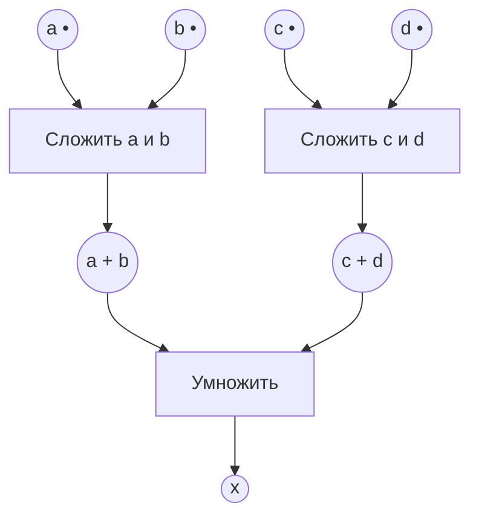

# Системы параллельной обработки данных: классификация Флинна, MPI и сети Петри

Подробный конспект по тексту лекции и слайдам из видео `spod 3.mp4`. Длительность записи — около 1 ч 26 мин 39 с. Таймкоды служат приблизительными ориентирами. Названия функций, параметры, примеры и состояния схем восстановлены по слайдам. Сети Петри перерисованы заново: в конспекте используются чёткие PNG, в архиве также сохранены векторные SVG. Технические уточнения к упрощённым или неточным формулировкам лекции выделены отдельно.

## Навигация по записи

| Время | Содержание |
|---|---|
| 00:01:30–00:10:00 | Архитектура фон Неймана, классификация Флинна, детерминизм |
| 00:10:00–00:12:40 | Параллельные алгоритмы, переход к MPI, пример распределения вектора |
| 00:12:40–00:24:10 | Процессы MPI, одна программа во многих процессах, `rank` и `size` |
| 00:24:10–00:28:10 | История MPI, балансировка нагрузки, компиляция и запуск |
| 00:28:10–00:32:40 | Парные и коллективные обмены, группы, коммуникаторы, топологии |
| 00:32:40–00:37:10 | Инициализация, завершение, структура программы, число и ранги процессов |
| 00:37:10–00:45:10 | Сообщения, типы данных, `MPI_Send`, `MPI_Recv`, статус |
| 00:45:10–00:54:00 | Происхождение и назначение сетей Петри, асинхронный FIFO |
| 00:54:00–01:05:40 | Элементы сети Петри, маркировка, срабатывание, «И» и «ИЛИ» |
| 01:05:40–01:10:50 | Пример изменения маркировок; сеть для арифметического выражения |
| 01:10:50–01:17:40 | Модель обмена Send–Recv и взаимная блокировка |
| 01:17:40–01:20:00 | Джокеры, измерение времени, коды завершения |
| 01:20:00–01:25:00 | Первая практическая работа и ошибки предложенной сети Петри |
| 01:25:00–конец | Требования к отчётам и организационные замечания |

## 1. Связь с предыдущей лекцией

- Ранее рассматривались параллельные алгоритмы, ускорение и эффективность.
- Ускорение и эффективность связаны, но улучшение загрузки вычислительных ресурсов само по себе не гарантирует уменьшения времени решения.
- Лектор напоминает пример, в котором удалось увеличить загрузку процессоров, но при этом потерять ускорение.
- Для оценки параллельной программы потребуются измерения времени при разном числе процессов и графики зависимости результата от этого числа.
- В этой лекции приоритет отдан материалу, необходимому для начала практических работ. Подробное рассмотрение принципов разработки параллельных алгоритмов отложено.

## 2. Архитектура фон Неймана

Ориентир: **00:01:30–00:02:20**.

На слайде названы четыре основных компонента:

1. **Память**, содержащая инструкции и данные.
2. **Блок управления**.
3. **Арифметико-логическое устройство — АЛУ**.
4. **Устройства ввода и вывода**.

Блок управления и АЛУ входят в центральный процессор, CPU. Процессор получает инструкции и данные и выполняет заданную обработку. На слайде базовая архитектура связывается с работами Джона фон Неймана 1945 года; подчёркивается её длительное влияние на устройство компьютеров.

## 3. Классификация Флинна

Ориентир: **00:02:20–00:10:00**.

Классификация Флинна, представленная на слайде как таксономия 1966 года, описывает вычислительные архитектуры по двум признакам:

- числу **потоков инструкций**;
- числу **потоков данных**.

Каждый поток может быть одиночным или множественным. Получаются четыре сочетания.

| Класс | Расшифровка | Потоки инструкций / данных | Основная идея |
|---|---|---|---|
| **SISD** | Single Instruction, Single Data | Один / один | Последовательная обработка одним вычислительным устройством |
| **SIMD** | Single Instruction, Multiple Data | Один / много | Одинаковая операция выполняется над разными данными |
| **MISD** | Multiple Instruction, Single Data | Много / один | Разные вычислительные потоки работают с одним потоком данных |
| **MIMD** | Multiple Instruction, Multiple Data | Много / много | Разные вычислительные устройства исполняют разные инструкции над разными данными |

### 3.1. SISD

- Связывается в лекции с последовательным компьютером и архитектурой фон Неймана.
- Один процессорный модуль получает инструкции и данные.
- Данные обрабатываются согласно текущей инструкции.
- В лекции отдельно обсуждается детерминированное исполнение.

### 3.2. Детерминизм

**Детерминированная программа** при одном и том же наборе входных данных даёт один и тот же результат. **Недетерминированная** может давать разные результаты или разный наблюдаемый порядок событий при одинаковом входе.

В дальнейшем примером станет приём сообщений от нескольких процессов: все требуемые сообщения могут быть получены правильно, но порядок их печати способен меняться от запуска к запуску.

**Уточнение.** Сам класс архитектуры по Флинну не является достаточным доказательством детерминированности произвольной программы. Для практической работы важно определить, что именно должно быть неизменным: численный результат, состав сообщений, порядок вывода или всё вместе.

### 3.3. SIMD

- Несколько вычислительных устройств выполняют одну и ту же команду над своими данными.
- В показанном примере разные процессы загружают элементы `A`, затем элементы `B`, выполняют одинаковую арифметическую операцию и сохраняют результаты.
- Подходит для большого числа однотипных операций над массивами данных.
- В качестве области применения названа обработка графики и изображений.
- На слайдах подчёркивается регулярность таких задач.

### 3.4. MISD

- Формально присутствует в классификации.
- На схеме показаны разные инструкции при общем потоке данных.
- Лектор не приводит конкретного практического примера и отмечает редкость реальных систем этого класса.
- Формулировка слайда: реальных примеров мало, «если вообще были». Это характеристика обсуждаемого учебного материала, а не доказательство невозможности такой архитектуры.

### 3.5. MIMD

- Каждый процессор, ядро или процессорный модуль выполняет свой поток инструкций со своими данными.
- На слайде один процессор загружает, вычисляет и сохраняет данные, другой вызывает функцию, третий выполняет свой участок программы.
- Исполнение разных частей может быть синхронным или асинхронным; наблюдаемое поведение — детерминированным или недетерминированным.
- В лекции это основной класс для современных параллельных суперкомпьютеров, кластеров и многопроцессорных систем, включая SMP.
- Производительность можно наращивать добавлением вычислительных узлов и стоек.
- При этом остаются отдельные инженерные вопросы энергопотребления, охлаждения и организации взаимодействия; подробно они здесь не рассматриваются.

### 3.6. Исторические иллюстрации

- В исторической подборке показаны UNIVAC I, IBM 360, CDC 7600, PDP-1, Cray-1 и обычный ноутбук.
- В блоке конвейерно-векторных машин приведены MasPar, Thinking Machines CM-2, Cray X-MP и Cray Y-MP.
- На слайде начало соответствующего исторического периода связывается с 1976 годом; лектор говорит об активном использовании таких суперкомпьютеров до 1990-х годов.
- Отдельная иллюстрация — новость от 24.08.2024 о выставлении Cray-1 из коллекции Пола Аллена на аукцион Christie’s. Лектор не сообщает подтверждённый результат продажи.

## 4. Разработка параллельных алгоритмов и распределение данных

Ориентир: **00:10:00–00:12:40**.

### 4.1. Почему недостаточно автоматически распараллелить готовый код

- Автоматическое преобразование последовательной программы в параллельную нередко неэффективно, а для некоторых алгоритмов и зависимостей невозможно в требуемом виде.
- Хороший параллельный алгоритм может требовать изменения самого способа решения задачи.
- Алгоритм следует выбирать с учётом аппаратной организации: общей или распределённой памяти, числа вычислительных устройств и стоимости взаимодействия.
- Само наличие параллельных ветвей не означает хорошего ускорения.

### 4.2. Геометрическое разбиение: блоки и циклическое распределение

При переключении презентаций кратко показан слайд с распределением **14 элементов вектора между четырьмя вычислителями**. Этот пример почти не отражён в устной расшифровке.

Размер делится с остатком: `14 = 3 × 4 + 2`. Поэтому два вычислителя получают по четыре элемента, два — по три.

| Вычислитель на рисунке | Блочное распределение — block | Циклическое распределение — cyclic |
|---|---|---|
| `n1` | 1, 2, 3, 4 | 1, 5, 9, 13 |
| `n2` | 5, 6, 7, 8 | 2, 6, 10, 14 |
| `n3` | 9, 10, 11 | 3, 7, 11 |
| `n4` | 12, 13, 14 | 4, 8, 12 |

- При **блочном** распределении каждому вычислителю принадлежит непрерывный участок.
- При **циклическом** соседние элементы по очереди выдаются разным вычислителям.
- Сформулированная на слайде задача — эффективно размещать порции данных с учётом порядка их готовности.
- Обозначения `n1`–`n4` относятся к этому рисунку; далее ранги MPI нумеруются с нуля.

## 5. MPI: стандарт, назначение и история

**MPI — Message Passing Interface**, стандартизованный программный интерфейс обмена сообщениями. В лекции он рассматривается для кластеров, суперкомпьютеров и MPP — Massively Parallel Processing.

- Для программиста реализация MPI выглядит как подключаемая библиотека функций.
- Сам MPI задаёт интерфейс и правила работы; конкретная библиотека реализует этот стандарт.
- Основное преимущество, подчёркнутое на слайде «Почему MPI?», — **переносимость параллельных программ** между компьютерными системами.
- Для практических работ нужно установить реализацию MPI на свою машину.
- Лектор отмечает доступность бесплатных реализаций.

Историческая последовательность, показанная на слайде около **00:24:10**:

| Период | Содержание |
|---|---|
| Апрель 1992 года | Совещание по стандартизации передачи сообщений в распределённой памяти, Williamsburg, Virginia, USA |
| Далее | Формирование рабочей группы и сообщества MPI Forum |
| 1994 год | Принятие MPI 1.0 |
| 1997 год | MPI 2.0: динамическое порождение и управление процессами, односторонние коммуникации, параллельный ввод-вывод |
| 2008–2009 годы | На слайде перечислены версии MPI 2.1 и 2.2 |
| 2012 год | MPI 3.0 |
| 2015 год | MPI 3.1; на слайде указано более 450 функций |
| 2020 год в историческом списке | Упоминается MPICH 3.4 — Message Passing Interface Chameleon |

**Уточнение.** MPICH — реализация MPI, а не очередная версия самого стандарта. Исторический список на слайде не следует читать как перечень последних доступных версий на дату просмотра. [Официальное описание MPICH](https://www.mpich.org/).

Отдельное замечание лектора: если вычисления распараллелены, а ввод-вывод остаётся последовательным, он может существенно уменьшить полученное ускорение. Параллельный ввод-вывод назван важной темой, но в этой лекции подробно не разбирается.

## 6. Параллельная программа MPI: процессы и общий код

Ориентир: **00:12:40–00:24:10**.

### 6.1. Процесс и процессор — разные сущности

**Параллельная программа в MPI** рассматривается как множество одновременно выполняемых процессов.

- Процессы могут выполняться на разных физических процессорах или ядрах.
- На одном процессоре может выполняться несколько процессов с разделением времени; их переключает планировщик.
- Параллельную программу можно запустить даже на одном процессоре.
- Число процессов `p` не обязано совпадать с числом физических процессоров `N`.
- На слайде отдельно показаны случаи `p ≤ N` и `p > N`.
- Пример из объяснения: запущено 100 процессов, а физических ядер четыре.

**Load balancing — балансировка нагрузки:** распределение процессов и работы по вычислительным ресурсам так, чтобы они использовались эффективно. К этому вопросу преподаватель планирует вернуться после начала практики.

### 6.2. Одна программа во многих процессах

На слайде модель названа **SPMP — Single Program Multiple Process**. Основные положения:

1. Одна программа запускается во всех процессах.
2. Процессы можно идентифицировать по рангу.
3. Доступны виртуальные топологии взаимодействия.
4. Несколько процессов могут работать на одном процессоре в режиме разделения времени.
5. Поддерживаются разные способы коммуникации и синхронизации.

**Уточнение терминологии.** Общепринятое название близкой модели — **SPMD, Single Program Multiple Data**: одинаковая программа работает с различными данными и может проходить разные ветви выполнения. Одна программа во всех процессах не превращает MPI в аппаратную SIMD-архитектуру и не требует одновременного исполнения одинаковых машинных команд. [Материал LLNL о моделях параллельного программирования](https://hpc.llnl.gov/documentation/tutorials/introduction-parallel-computing-tutorial).

### 6.3. `rank` и `size`

- `rank` — ранг, номер текущего процесса **в конкретном коммуникаторе**.
- `size` — число процессов **в этом коммуникаторе**.
- Ранги находятся в диапазоне от `0` до `size − 1`.
- Одинаковый вызов получения ранга в разных процессах возвращает разные значения.
- Ранг используется для выбора данных, ветви алгоритма и адресата сообщения.

### 6.4. Одна операция над разными данными

На слайде рассмотрено сложение векторов `C = A + B`:

```c
C[rank] = A[rank] + B[rank];
```

Каждый процесс выполняет одинаковую операцию, но над элементами, определёнными его рангом. В учебном примере процесс с рангом `i` вычисляет `C[i] = A[i] + B[i]`. Это иллюстрация параллелизма по данным, а не полный алгоритм распределения вектора произвольного размера.

### 6.5. Разные части одной программы

На слайде используется условие по рангу:

```text
if rank < size / 2:
    первая часть алгоритма
else:
    вторая часть алгоритма
```

- Процессы одной группы выполняют первую ветку, остальные — вторую.
- Исходный код у всех одинаковый, но выполняемые участки различаются.
- Так объясняется возможность реализовать разные вычислительные потоки в рамках одной программы.
- Знать свой `rank` и размер `size` практически необходимо во всех последующих примерах.

## 7. Парные обмены, группы и коммуникаторы

Ориентир: **00:28:10–00:31:10**.

### 7.1. Два основных класса операций

| Класс | Содержание |
|---|---|
| **Парные, point-to-point** | Обмен между двумя процессами: отправка и соответствующий приём |
| **Коллективные** | Согласованные действия группы процессов: например, один передаёт всем или все передают одному |

Слово «все» относится к процессам выбранного коммуникатора, а не обязательно ко всем процессам программы вообще.

### 7.2. Что определяет коммуникатор

**Коммуникатор** задаёт группу участников и контекст обмена сообщениями. В лекции используется образ «зоны взаимодействия».

- В рассматриваемых внутригрупповых обменах участники используют один и тот же коммуникатор.
- Коллективная операция относится ко всем участникам соответствующей группы; одному процессу нельзя произвольно считать её локальным действием.
- В ходе программы могут создаваться и освобождаться группы и коммуникаторы.
- Один процесс может входить в несколько групп и коммуникаторов.
- Его ранг в разных коммуникаторах может отличаться.
- Ранг без указания коммуникатора нельзя считать глобальным идентификатором процесса на все случаи.

### 7.3. `MPI_COMM_WORLD`

- В обычной модели запуска MPI предоставляется исходный коммуникатор `MPI_COMM_WORLD`.
- В учебных примерах он объединяет все процессы первоначального запуска.
- На первых работах предполагается использование именно этого коммуникатора.
- Поэтому поначалу `size` совпадает с общим числом запущенных процессов.

### 7.4. Интеркоммуникатор

Для взаимодействия **между двумя отдельными непересекающимися группами** используется **intercommunicator — интеркоммуникатор**. На слайде он назван «глобальным коммуникатором».

Важно различать внутригрупповой коммуникатор и средство обмена между группами. Наличие нескольких групп само по себе не создаёт интеркоммуникатор автоматически: его создание — отдельное действие программы.

## 8. Виртуальная топология

Ориентир: **00:31:10–00:32:40**.

- Топология описывает логическую структуру связей между процессами.
- В лекции в качестве возможных структур обсуждаются матрица, решётка, дерево, граф.
- MPI предоставляет средства описания решёток произвольной размерности и графов.
- Выбор логической топологии связан с характером решаемой задачи.
- Отдельная практическая работа будет посвящена виртуальным топологиям.

На слайде исходная логическая связность описана как **полный граф**: в рамках соответствующей группы можно организовать обмен между любыми процессами.

**Уточнение.** Это характеристика доступного логического взаимодействия. Она не означает, что физическая сеть обязательно полносвязная, что между каждой парой есть выделенный прямой канал или что MPI автоматически прикрепил к `MPI_COMM_WORLD` специальную топологию графа. Логическую топологию и физические соединения следует различать.

## 9. Компиляция и запуск MPI-программы

Ориентир: **00:26:10–00:28:10**.

В лекции предпочтение отдано C/C++; примеры интерфейса показаны для C.

Пример компиляции и запуска со слайда:

```bash
mpicc program.c -o program.x
mpirun -np 4 ./program.x
```

- `mpicc` — команда компиляции C-программы с поддержкой выбранной реализации MPI.
- `mpirun` запускает подготовленную программу.
- `-np 4` задаёт число запускаемых процессов.
- На слайде параметр записан обобщённо: `-np p`.
- Расширение `.x` — используемое в примере имя исполняемого файла, а не универсальное требование MPI.
- При запуске `p` процессов их исходные ранги в `MPI_COMM_WORLD` — `0, 1, …, p − 1`.
- Для рассматриваемой модели MPI 1.0 число процессов задаётся при запуске и в ходе вычисления не меняется. Динамическое управление процессами в лекции отнесено к MPI 2.0.

**Требование преподавателя:** программа должна быть масштабируемой — один раз написанной и отлаженной, способной работать при разных допустимых значениях `p`. Нельзя каждый раз переделывать код под конкретное число процессов.

## 10. Инициализация, завершение и структура программы

Ориентир: **00:32:40–00:37:10**.

### 10.1. Основные вызовы

```c
int MPI_Init(int *argc, char ***argv);
int MPI_Finalize(void);
int MPI_Comm_size(MPI_Comm comm, int *size);
int MPI_Comm_rank(MPI_Comm comm, int *rank);
```

| Вызов | Назначение |
|---|---|
| `MPI_Init(&argc, &argv)` | Инициализация среды MPI в текущем процессе |
| `MPI_Finalize()` | Завершение работы с MPI в текущем процессе |
| `MPI_Comm_size(comm, &size)` | Получение числа процессов в коммуникаторе |
| `MPI_Comm_rank(comm, &rank)` | Получение собственного ранга в коммуникаторе |

В C в `MPI_Init` передаются адреса `argc` и `argv` функции `main`. Базовые операции обмена рассматриваемой программы находятся между инициализацией и завершением.

### 10.2. Скелет программы по слайдам

```c
#include <mpi.h>

int main(int argc, char *argv[])
{
    int size;
    int rank;

    MPI_Init(&argc, &argv);
    MPI_Comm_size(MPI_COMM_WORLD, &size);
    MPI_Comm_rank(MPI_COMM_WORLD, &rank);

    /* Вычисления и обмен сообщениями с учётом size и rank. */

    MPI_Finalize();
    return 0;
}
```

На слайдах допускаются участки обычного кода до `MPI_Init` и после `MPI_Finalize`.

**Уточнение.** Процессы уже созданы командой запуска: `MPI_Init` не является оператором, который превращает единственный процесс в несколько. Код до и после этих вызовов также выполняется каждым процессом, дошедшим до него. Если действие требуется только один раз, его нужно организовать явно. До инициализации и после завершения нельзя произвольно вызывать операции обмена MPI; Open MPI рекомендует свести внешние действия в этих участках к минимуму. Передача `argc` и `argv` в `MPI_Init` сама по себе не является рассылкой пользовательских данных между процессами. [Документация MPI_Init](https://docs.open-mpi.org/en/main/man-openmpi/man3/MPI_Init.3.html).

## 11. Устройство сообщения MPI

Ориентир: **00:37:10–00:39:00**.

На слайде сообщение разбито на две части: **данные** и **сопроводительную информацию — оболочку, конверт**. При описании операции используются три параметра данных и три параметра оболочки.

| Часть | Параметр | Смысл |
|---|---|---|
| Данные | `buf` | Начальный адрес буфера |
| Данные | `count` | Число элементов |
| Данные | `datatype` | Тип одного элемента |
| Оболочка | `dest` при отправке / `source` при приёме | Ранг адресата или отправителя |
| Оболочка | `tag` | Метка сообщения |
| Оболочка | `comm` | Коммуникатор, контекст взаимодействия |

**Принципиально:** `count` задаётся в элементах указанного типа, а не автоматически в байтах или битах. Например, при `MPI_INT` значение `count = 10` означает десять целых элементов.

Тег — целочисленная метка, по которой можно различать сообщения. В рассматриваемой отправке он неотрицательный. Это не сами данные сообщения и не номер процесса.

Аналогия из лекции: управляющая компания отправляет счёт. Получатель соответствует `dest`, месяц или период счёта — `tag`, а категория услуги, например электричество или телефон, — контексту, который иллюстрирует `comm`.

## 12. Типы данных MPI

Ориентир: **00:39:40–00:40:20**.

### 12.1. Базовые типы для C

На слайде приведены соответствия между типами MPI и C. Ниже сохранены показанные группы; строка `MPI_CHAR` приведена в соответствии с современным стандартным соответствием, а `MPI_SIGNED_CHAR` добавлена, чтобы не смешивать `char` и `signed char`.

| Тип MPI | Тип C / назначение |
|---|---|
| `MPI_CHAR` | `char` |
| `MPI_SIGNED_CHAR` | `signed char` |
| `MPI_SHORT` | `signed short int` |
| `MPI_INT` | `signed int` |
| `MPI_LONG` | `signed long int` |
| `MPI_UNSIGNED_CHAR` | `unsigned char` |
| `MPI_UNSIGNED_SHORT` | `unsigned short int` |
| `MPI_UNSIGNED` | `unsigned int` |
| `MPI_UNSIGNED_LONG` | `unsigned long int` |
| `MPI_FLOAT` | `float` |
| `MPI_DOUBLE` | `double` |
| `MPI_LONG_DOUBLE` | `long double` |
| `MPI_BYTE` | Байт данных; отдельное соответствие типу C на слайде не задано |
| `MPI_PACKED` | Упакованные данные MPI; отдельное соответствие типу C на слайде не задано |

Для базового обмена отправитель и получатель должны согласовать передаваемые типы. На слайде `MPI_CHAR` сопоставлен с `signed char`; при написании кода полезно различать эти типы явно. [Таблица типов в стандарте MPI](https://www.mpi-forum.org/docs/mpi-4.1/mpi41-report/node57.htm).

### 12.2. Производные типы

Производные типы создаются во время выполнения программы из базовых типов с помощью конструкторов. На слайде перечислены:

- `Struct`;
- `Vector`;
- `Hvector`;
- `Indexed`;
- `Hindexed`.

Они позволяют описывать структуры и расположение данных сложнее простого непрерывного массива. Лектор отмечает, что до подробного использования таких типов в текущей практике, вероятно, не дойдёт.

**Уточнение к слайду.** Подпись «H — hash table» не описывает смысл MPI-конструкторов `Hvector` и `Hindexed`. Здесь существенны смещения в байтах; например, у `MPI_Type_create_hvector` шаг между блоками задаётся в байтах, а не в элементах базового типа. Речь не о хеш-таблицах и не о «гипервекторах». [Документация Hvector](https://docs.open-mpi.org/en/main/man-openmpi/man3/MPI_Type_create_hvector.3.html), [документация Hindexed](https://docs.open-mpi.org/en/main/man-openmpi/man3/MPI_Type_create_hindexed.3.html).

## 13. Отправка: `MPI_Send`

Ориентир: **00:39:00–00:43:00**.

```c
int MPI_Send(
    const void *buf,
    int count,
    MPI_Datatype datatype,
    int dest,
    int tag,
    MPI_Comm comm
);
```

На слайде параметр типа назван `type`; имя параметра не меняет смысла интерфейса.

- `buf` — адрес отправляемых данных.
- `count` — количество элементов.
- `datatype` — тип элементов.
- `dest` — ранг получателя в соответствующем коммуникаторе.
- `tag` — метка сообщения.
- `comm` — коммуникатор.

### 13.1. Что означает блокировка

- Это **блокирующая отправка стандартного режима**.
- Пока вызов не завершён, отправляющий поток не продолжает код после него.
- После успешного возврата из вызова отправляющий буфер можно повторно использовать: например, менять его содержимое, не повреждая это сообщение.
- До завершения операции такой гарантии нет.

### 13.2. Промежуточная буферизация

На слайде описаны два варианта обеспечения завершения отправки:

1. Копирование сообщения в промежуточный буфер MPI.
2. Передача данных непосредственно при взаимодействии с получателем.

Выбор зависит от реализации. В устном объяснении небольшие сообщения связываются с промежуточным буфером. Численный порог «небольшого» сообщения в лекции не задан.

**Уточнение.** Возврат из `MPI_Send` не означает обязательного завершения приёма другой стороной: отправка могла завершиться за счёт буферизации. Нельзя строить корректность программы на предположении, что стандартная отправка всегда буферизуется или всегда ждёт получателя. Различие буферизованного и небуферизованного поведения нельзя сводить к утверждению «в MPI 1 буфера не было, в следующих версиях появился». [Стандарт MPI: режимы коммуникации](https://www.mpi-forum.org/docs/mpi-2.2/mpi22-report/node53.htm).

### 13.3. Нулевая длина и отправка самому себе

- Допускается `count = 0`: полезных элементов нет, но операция обмена и её оболочка остаются.
- В лекции такой обмен упоминается как средство координации двух процессов; также назван барьер как отдельное средство синхронизации.
- Нулевая длина сама по себе не превращает `MPI_Send` в универсальный барьер и не отменяет необходимость соответствующего протокола приёма.
- Отправить сообщение самому себе возможно, но последовательность блокирующих вызовов способна привести к тупику. Лектор не рекомендует такой вариант для рассматриваемых задач.

## 14. Приём: `MPI_Recv`, статус и фактический размер

Ориентир: **00:43:00–00:45:10**.

```c
int MPI_Recv(
    void *buf,
    int count,
    MPI_Datatype datatype,
    int source,
    int tag,
    MPI_Comm comm,
    MPI_Status *status
);
```

### 14.1. Параметры и согласование обмена

- `buf` — принимающий буфер.
- `count` — **максимальное** число элементов, которое разрешено записать в этот буфер.
- `datatype` — тип принимаемых элементов.
- `source` — допустимый отправитель.
- `tag` — допустимая метка сообщения.
- `comm` — контекст взаимодействия.
- `status` — структура с результатом операции.

Чтобы сообщение было принято данным вызовом, должны согласоваться адресат, источник, тег и коммуникатор с учётом допустимых джокеров.

Приём может быть вызван до начала соответствующей отправки или после её начала. Он блокирует принимающий поток до получения сообщения в буфер. После успешного возврата принятые данные доступны.

### 14.2. Ёмкость буфера и количество принятых элементов

- Буфер должен вмещать сообщение.
- Допускается принять меньше элементов, чем указано в `count`.
- `count = 100` в приёме не означает, что фактически обязательно придёт 100 элементов: может прийти, например, два.
- Если сообщение больше допустимого объёма, возникает ошибка усечения, `MPI_ERR_TRUNCATE`.
- Для последующей передачи нужно использовать фактически полученное количество, а не автоматически максимальную ёмкость буфера.

### 14.3. Поля статуса

| Поле | Содержание |
|---|---|
| `status.MPI_SOURCE` | Фактический ранг отправителя |
| `status.MPI_TAG` | Фактический тег принятого сообщения |

Фактическое количество элементов получают отдельным вызовом:

```c
int MPI_Get_count(
    const MPI_Status *status,
    MPI_Datatype datatype,
    int *count
);
```

Пример использования результата приёма:

```c
int received_count;
MPI_Get_count(&status, MPI_INT, &received_count);
```

Здесь `received_count` — число элементов `MPI_INT`, а не размер в байтах. [Документация приёма и определения фактического количества](https://docs.open-mpi.org/en/main/man-openmpi/man3/MPI_Recv.3.html).

## 15. Блокирующее, синхронное и неблокирующее взаимодействие

В устном объяснении синхронная операция описывается как ожидание подтверждения от другой стороны, а асинхронная — как возможность продолжить выполнение с последующей проверкой результата.

Для практического кода следует различать **два отдельных признака**: блокирует ли вызов выполнение и какой режим передачи он использует.

| Понятие / пример | Точный смысл |
|---|---|
| Блокирующий вызов | Управление возвращается после выполнения условий завершения данной операции |
| `MPI_Send` | Блокирующая отправка **стандартного** режима; может использовать внутреннюю буферизацию |
| `MPI_Ssend` | Блокирующая отправка **синхронного** режима; завершение требует, чтобы соответствующий приём был начат |
| Неблокирующая операция, например `MPI_Isend` | Возвращает управление до завершения обмена; завершение нужно отдельно ожидать или проверять |

**Уточнение.** Блокирующая стандартная отправка и синхронный режим — не одно и то же. Аналогично, неблокирующий вызов не означает мгновенного завершения передачи и не разрешает сразу переиспользовать её буфер. В лекции упоминается необходимость позднее проверить, произошло ли взаимодействие. Для неблокирующих операций завершение можно ожидать или проверять через `MPI_Wait` и `MPI_Test`. [Описание MPI_Send](https://docs.open-mpi.org/en/main/man-openmpi/man3/MPI_Send.3.html), [описание MPI_Ssend](https://docs.open-mpi.org/en/main/man-openmpi/man3/MPI_Ssend.3.html), [описание MPI_Isend и контроля завершения](https://docs.open-mpi.org/en/main/man-openmpi/man3/MPI_Isend.3.html).

Эта разница особенно важна при чтении дальнейших схем: модели на слайдах специально построены **без учёта промежуточной буферизации небольшого сообщения**.

## 16. Зачем нужны сети Петри

Ориентир: **00:45:10–00:54:00**.

### 16.1. Назначение

**Сеть Петри — наглядная математическая модель параллельных процессов, их взаимодействия и синхронизации.**

Она нужна, когда словесного описания «процесс ждёт», «приёмник готов», «передача началась», «подтверждение ещё не пришло» недостаточно для уверенной проверки протокола.

Программа тоже формально описывает поведение, но длинный код, особенно чужой, труднее анализировать как схему взаимодействия. Сеть Петри выделяет условия, действия и возможные изменения состояния.

### 16.2. Происхождение и область применения

- Название связано с немецким учёным **Карлом Адамом Петри — Carl Adam Petri, 1926–2010**.
- На историческом слайде теория связывается с его диссертацией в Дармштадтском техническом университете; на этом слайде указан 1961 год.
- В качестве исходной идеи описана «растяжимая» архитектура: компоненты автономны, система работает асинхронно, глобальная синхронность не является обязательной основой.
- Приводится асинхронное запоминающее устройство магазинного типа, в котором модуль взаимодействует с двумя соседями.
- Сети Петри применяются не только в параллельном программировании; лектор упоминает международные конференции и большую научную литературу.
- Среди разновидностей названы взвешенные, окрашенные, временные сети и варианты с дополнительными ограничениями.

### 16.3. Что даёт модель

| Возможность | Что можно увидеть или проверить |
|---|---|
| Наглядность | Где идут параллельные процессы, где они ждут друг друга и объединяются |
| Естественное описание параллелизма | Независимые ветви представлены непосредственно в модели |
| Синхронизация | Для начала действия должны выполниться несколько условий |
| Поиск тупиков | Состояния, в которых требуемое продолжение невозможно |
| Общие ресурсы | Конкуренция и конфликты между процессами |
| Достижимость | Возможно ли прийти к определённому состоянию |
| Безопасность и ограничения | Не возникают ли недопустимые состояния и накопление маркеров |
| Продолжение работы | Сохраняется ли возможность выполнения нужных действий |

Сети Петри не привязаны к одному языку программирования. Упомянуты пакеты анализа и средства, способные получать программное представление из модели. Для учебных примеров предполагается ручной разбор: объём достаточно мал.

Лектор отдельно упоминает **k-ограниченность** как свойство, которое будет разобрано позже. Краткий смысл: во всех достижимых состояниях в каждой позиции не должно быть более `k` маркеров; безопасность в обычном смысле 1-ограниченной сети означает максимум один маркер на позицию.

### 16.4. Практический пример ценности проверки

Из опыта лектора: в группе Варшавского проектировали асинхронный интерфейс для реализации в микросхеме; изготовление связывается с Воронежем. В работе участвовал Александр Владимирович Яковлев. После многократной проверки словесного и рукописного описания построили сеть Петри на большом листе и обнаружили две ошибки до передачи решения в производство.

Смысл примера: понятное участникам описание ещё не гарантирует отсутствия ошибок взаимодействия; смена представления помогает обнаружить их заранее.

## 17. Асинхронный FIFO

Ориентир: **00:49:30–00:52:10**.

**FIFO — First In, First Out:** данные выходят в том порядке, в котором поступили.

На слайде изображена цепочка регистров `R1, R2, R3, …, R(n−1), Rn`, согласующая две вычислительные части с разными скоростями работы.

1. Левый блок записывает данные в `R1`.
2. При свободном следующем регистре данные могут передвинуться дальше, освобождая предыдущий.
3. Если буфер был пуст, первая порция доходит до последнего регистра `Rn`.
4. Следующая порция останавливается перед уже занятой позицией, например в `R(n−1)`.
5. Правый блок считывает данные из `Rn` со своей скоростью.
6. Освободившееся место позволяет сдвинуть следующие порции; слева в это время могут появляться новые данные.

- Обмен внутри цепочки происходит асинхронно относительно левого и правого вычислительных блоков.
- На рисунке крупные стрелки показывают данные, тонкие — управляющие сигналы.
- Показана регистровая реализация, но FIFO можно реализовать и на памяти.
- Словесно описывать все возможные сочетания записи, сдвига и считывания неудобно; это мотивация для формальной модели.

## 18. Из чего состоит сеть Петри

Ориентир: **00:54:00–00:57:20**.

В рассматриваемом базовом варианте это **двудольный ориентированный граф с начальной маркировкой**.


*Рисунок 1. Заново построенная линейная сеть по примеру со слайда. Имена P1–P3 и T1–T2 добавлены для чтения схемы; показаны исходная маркировка и разрешённый переход. Ориентир в видео — около 00:54:15.*

| Элемент | Обозначение на слайдах | Смысл |
|---|---|---|
| Позиция | Кружок | Условие, состояние, наличие ресурса или готовность |
| Переход | Палочка | Действие, оператор, функция, событие |
| Дуга | Направленная стрелка | Связь между условием и действием |
| Маркер, метка | Точка внутри позиции | Текущее выполнение условия или наличие моделируемого ресурса |
| Маркировка, разметка | Распределение маркеров по позициям | Состояние всей модели |
| Начальная маркировка | Исходное расположение точек | Начальное состояние |
| Звёздочка возле перехода | Вспомогательная пометка лектора | Переход возбуждён, то есть разрешён к срабатыванию |

### 18.1. Почему граф двудольный

Дуги соединяют вершины **разных типов**:

- позиция → переход;
- переход → позиция.

Непосредственная связь «позиция → позиция» или «переход → переход» в этой модели не допускается. Между двумя кружками должна быть палочка; между двумя палочками — кружок.

### 18.2. Зачем обязательно задавать начальную маркировку

- Один и тот же граф при разных начальных метках может вести себя по-разному.
- Маркер не обязан быть единственным во всей сети.
- В одной позиции в общем случае может быть несколько маркеров.
- Без указания исходного распределения маркеров нельзя однозначно разбирать поведение модели.
- **Прямое требование преподавателя:** в отчёте по практической работе указывать начальную маркировку. Одного рисунка связей недостаточно.

Необходимо различать **статическую структуру** — позиции, переходы, дуги — и **динамику** — смену маркировок при выполнении действий.

## 19. Правила срабатывания перехода

Ориентир: **00:57:20–00:59:30**.

В лекции рассматриваются обычные дуги единичной кратности.

1. Переход **возбуждён**, если **каждая входная позиция** содержит хотя бы один маркер.
2. Если хотя бы одна необходимая входная позиция пуста, переход не возбуждён.
3. Возбуждение означает возможность срабатывания. Точный момент срабатывания в этой базовой модели заранее не задаётся.
4. Само срабатывание считается **неделимым, атомарным** действием с нулевой длительностью.
5. Одновременно из каждой входной позиции извлекается по одному маркеру.
6. Одновременно в каждую выходную позицию добавляется по одному маркеру.
7. Сеть переходит к новой маркировке, и условия разрешённости переходов проверяются уже для неё.

Нулевая длительность изменения маркировки не означает нулевого времени реальной передачи данных или вычисления. Это абстракция выбранной модели.

Пример проверки: если у перехода две входные позиции и в них `(3, 0)` маркеров, переход запрещён. При `(2, 1)` он разрешён; после одного срабатывания во входных позициях останется `(1, 0)`, если нет обратных дуг к этим же позициям.

Для запоминания правило можно записать как:

`новая маркировка = старая маркировка − потреблённые маркеры + созданные маркеры`.

Важно: маркеры в общем случае не сохраняют общее количество. При переходе с двумя входами и одним выходом их может стать меньше; при одном входе и двух выходах — больше.

## 20. Конструкции «И» и «ИЛИ»

Ориентир: **00:59:30–01:05:40**.

### 20.1. Переход: «И» по входу и по выходу

- Если у перехода несколько входных позиций, нужны маркеры **во всех**: это синхронизация по «И».
- Несколько маркеров в одной позиции не заменяют отсутствующий маркер в другой.
- После срабатывания маркер появляется **в каждой** выходной позиции: действие может породить несколько дальнейших ветвей.

Разбираемый на слайде пример:

| Состояние входных позиций | Разрешённость | Результат |
|---|---|---|
| В первой один маркер, во второй ноль | Переход не возбуждён | Ничего не меняется |
| В первой два маркера, во второй ноль | Всё ещё не возбуждён | Накопление слева не заменяет второе условие |
| В первой два маркера, во второй один | Возбуждён | Может сработать |
| После срабатывания | Во входах остаются один и ноль | В каждую выходную позицию добавлено по маркеру |


*Рисунок 2. Перерисованная конструкция «И». Четыре состояния соответствуют разобранной выше таблице: (1, 0), (2, 0), (2, 1) на входах и результат одного срабатывания. Ориентир в видео — около 01:02:45.*

### 20.2. Позиция: альтернативные пути

Для кружков лектор использует образ «ИЛИ»:

- позиция может получить маркер от одного из нескольких входящих переходов;
- один маркер в общей входной позиции может разрешить несколько альтернативных переходов;
- если они конкурируют за этот единственный маркер, срабатывание одного исключает одновременное использование этого же маркера другим.

На слайде один маркер может пойти либо в левую, либо в правую нижнюю ветвь. В общем случае выбор не задан заранее.


*Рисунок 3. Перерисованная конструкция «ИЛИ»: поступление маркера в общую позицию M и два альтернативных результата конфликта. После T1 разрешены T3 и T4, но единственный маркер M может потребить только один из них. Ориентир в видео — около 01:05:15.*

### 20.3. Конфликт и управляемое ветвление

- Если программа должна выбрать определённую ветвь, это условие нужно отразить в модели.
- Лектор приводит аналогию с `if`: добавление условий позволяет разрешить только нужный переход.
- Модель не должна допускать произвольный выбор там, где реальный алгоритм его не допускает.

**Уточнение.** Наличие нескольких возбуждённых переходов само по себе не ошибка: независимые переходы как раз описывают параллелизм. Важен **конфликт за общие маркеры** и соответствие допустимых вариантов поведения исходной задаче. У обычных неокрашенных маркеров нет встроенных значений «истина» или «ложь»: условия ветвления надо явно моделировать.

## 21. Подробный пример с позициями P1–P4

Ориентир: **01:05:40–01:10:00**.

На слайде у верхней средней позиции местами не видно обозначения `P2`; преподаватель обращает на это внимание. Остальные позиции — `P1`, `P3`, `P4`, переходы — `T1`, `T2`, `T3`.

### 21.1. Восстановленная структура схемы

| Переход | Входные позиции | Выходные позиции |
|---|---|---|
| `T1` | `P1`, `P2`, `P3` | `P1` |
| `T2` | `P4` | `P2`, `P3` |
| `T3` | `P3` | `P4` |

У `P1` и `T1` есть обратная связь: при срабатывании `T1` маркер из `P1` извлекается и сразу возвращается в `P1`. Поэтому наличие маркера там необходимо, но его число при этом не меняется.

### 21.2. Изменение маркировок

Записываем маркировку в порядке `(P1, P2, P3, P4)`.

| Шаг | Маркировка | Возбуждённые переходы | Объяснение |
|---|---|---|---|
| Исходная | `(1, 0, 1, 0)` | `T3` | Для `T1` не хватает `P2`; для `T2` — `P4` |
| Сработал `T3` | `(1, 0, 0, 1)` | `T2` | Маркер перешёл из `P3` в `P4` |
| Сработал `T2` | `(1, 1, 1, 0)` | `T1`, `T3` | Из `P4` маркер изъят; в `P2` и `P3` добавлено по маркеру |
| Выбрано срабатывание `T1` | `(1, 0, 0, 0)` | Нет | Маркеры `P2` и `P3` потреблены, `P1` остался; получен тупик |
| Вместо этого выбран `T3` | `(1, 1, 0, 1)` | `T2` | Модель продолжает работу по другой ветви |
| Затем снова `T2` | `(1, 2, 1, 0)` | `T1`, `T3` | Новая маркировка отличается от предыдущей похожей схемы числом маркеров в `P2` |


*Рисунок 4. Перерисованные маркировки сети P1–P4: M0 → M1 → M2, далее выбор между продолжением M3 и тупиком M4. В каждой панели отдельно проверены разрешённые переходы. Ориентир в видео — около 01:06:45.*

Главные выводы:

- Одинаковый набор возбуждённых переходов не означает одинаковой маркировки.
- Вариант дальнейшего срабатывания влияет на результат.
- Если сработал `T1`, возбуждение `T3` исчезает без его срабатывания: необходимый маркер уже потреблён.
- В тупиковой ветви нет разрешённых переходов, хотя маркер в сети ещё есть.
- Схема годится для описания не только программ: лектор приводит аналогию с нерегулируемым перекрёстком и правилом помехи справа.

**Дополнительный вывод из самого рисунка:** повторяя `T3 → T2`, можно накапливать маркеры в `P2`. Поэтому проверять нужно не только тупики, но и ограничения на число маркеров. Этот вывод получается из восстановленных дуг и показанного правила срабатывания.

## 22. Сеть для вычисления арифметического выражения

Ориентир: **01:10:00–01:10:50**.

Показано выражение:

`x = (a + b) × (c + d)`.

- Подготовка исходных `a`, `b`, `c`, `d` может идти независимо.
- Сложение `a + b` разрешено после готовности обоих операндов.
- Сложение `c + d` имеет такое же условие и независимо от первого сложения.
- Умножение ждёт готовности **обеих сумм**.
- Результат появляется в конечной позиции `x`.


*Рисунок 5. Перерисованная сеть для `x = (a + b) × (c + d)` с подготовкой операндов, двумя сложениями и умножением. Показана исходная маркировка до подготовки a, b, c и d. Ориентир в видео — около 01:10:15.*

Упрощённая схема после подготовки исходных данных; прямоугольники обозначают переходы, кружки — позиции. Начальная маркировка этого фрагмента: по одному маркеру готовности в `a`, `b`, `c`, `d`, остальные позиции пусты.



Сравнение с обычным графом алгоритма: граф показывает зависимости и позволяет рассуждать о ярусах и числе параллельных исполнителей, а сеть с маркировкой дополнительно показывает текущую готовность, ожидание и смену состояний.

## 23. Сеть Петри для взаимодействия Send–Recv

Ориентир: **01:10:50–01:14:20**.

Рассматриваются два процесса:

- процесс `0` отправляет сообщение;
- процесс `1` принимает сообщение.

На слайдах специально указано: **возможная промежуточная буферизация небольшого сообщения не учитывается**. Поэтому модель содержит ожидание приёма другой стороной.

### 23.1. Почему недостаточно одной связи отправки с приёмом

Если нарисовать только передачу маркера от `Send` к `Recv`, отправитель после отправки сможет продолжить свою ветку. Такая схема не показывает требуемую в этом примере блокировку.

Чтобы описать ожидание, в ветке отправителя вводится дополнительный переход, для которого нужны:

1. его собственная готовность продолжить работу;
2. условие, получаемое после приёма сообщения второй стороной.


*Рисунок 6. Перерисованный основной фрагмент схемы Send–Recv: продолжение отправителя зависит от приёма второй стороной. Предшествующие вычисления опущены; возможная промежуточная буферизация не моделируется. Ориентир в видео — около 01:12:15.*

### 23.2. Последовательность маркировок на слайде

| Стадия | Процесс 0 | Процесс 1 | Смысл |
|---|---|---|---|
| До отправки | Разрешён переход начала отправки | Ожидает сообщение | Процессы дошли до обмена |
| Отправка начата | Маркер собственной готовности уже есть, подтверждения ещё нет | Появился маркер доступного сообщения; `Recv` разрешён | Отправитель ещё не может пройти блокирующее продолжение |
| Приём произошёл | Появилось условие подтверждения | Может продолжить свою ветку | Теперь разрешено продолжение отправителя |
| Продолжение | Прошёл следующий переход | Продолжает работу | Обмен в данной модели завершён |


*Рисунок 7. Четыре заново нарисованных состояния модели Send–Recv. Панели читаются по номерам: готовность отправки, готовность приёма, разрешение продолжения отправителя и завершение обмена. Ориентир в видео — около 01:12:45.*

**Уточнение.** Обратная связь на рисунке моделирует зависимость и подтверждение в протоколе взаимодействия. Из неё не следует, что в пользовательской MPI-программе обязательно нужно добавить ещё один отдельный `MPI_Send` с подтверждением. Это зависит от моделируемого протокола. Условия завершения реальных MPI-вызовов нужно отличать от условных действий учебной схемы.

## 24. Взаимная блокировка — deadlock

Ориентир: **01:14:20–01:17:40**.

**Дедлок** — состояние, при котором участники не могут продолжить выполнение из-за взаимного ожидания необходимых действий или условий.

### 24.1. Два варианта со слайда

В исходном слайде смешаны обозначения «первая/вторая ветвь» и ранги `0/1`; преподаватель замечает ошибку нумерации. Ниже адресаты приведены к единой нумерации.

| Вариант | Процесс 0 | Процесс 1 | Причина проблемы |
|---|---|---|---|
| Сначала оба отправляют | `Send(в 1)`, затем `Recv(от 1)` | `Send(в 0)`, затем `Recv(от 0)` | При отсутствии подходящей буферизации оба могут ждать приёма, до которого ни один ещё не дошёл |
| Сначала оба принимают | `Recv(от 1)`, затем `Send(в 1)` | `Recv(от 0)`, затем `Send(в 0)` | Оба ждут сообщения; необходимые отправки стоят дальше в заблокированных программах |

Первый вариант разобран подробно на сети Петри:

1. У обоих процессов разрешено начало отправки.
2. После него локальные маркеры готовности есть, сообщения направлены к противоположным ветвям.
3. Чтобы перейти к приёму, каждому нужно завершить предыдущее ожидание.
4. Для завершения ожидания нужно подтверждение приёма другой стороной.
5. Но обе стороны до своего приёма ещё не дошли.
6. Позиции подтверждения, выделенные на слайде красным, остаются пустыми.
7. Нет возбуждённых переходов — модель остановилась в тупике.


*Рисунок 8. Перерисованная модель дедлока: слева оба перехода отправки разрешены, справа после их начала достигнут тупик. Красным выделены пустые позиции недостающих подтверждений; пересечения дуг не являются вершинами. Ориентир в видео — около 01:17:15.*

### 24.2. Что важно при анализе программы

- Остановка одной ветви не всегда означает видимую остановку всей программы: другие независимые ветви могут продолжать работать.
- Частично полученный или преждевременно выведенный результат способен скрыть зависшую ветку.
- Поэтому нужно проверять завершение необходимых взаимодействий, а не только появление какого-то вывода.
- Ручной просмотр маркировок маленькой сети уже позволяет увидеть такую ошибку.

**Уточнения для практики.**

- Для `MPI_Send` вариант «оба сначала отправляют» нельзя считать безусловным дедлоком при любой длине сообщения: внутренней буферизации иногда достаточно, чтобы он прошёл. Именно зависимость от неё делает такой протокол ненадёжной основой переносимой программы. Для синхронной отправки ожидание соответствующего приёма принципиально.
- Само применение неблокирующих вызовов не доказывает отсутствие тупика: значение имеют порядок запуска операций и места ожидания их завершения.
- Отсутствие возбуждённых переходов нужно оценивать вместе с целью модели. Нормально завершившаяся конечная программа тоже может больше не иметь разрешённых действий; ошибочный тупик — остановка до требуемого результата.

## 25. Дополнительные средства MPI: джокеры, время, коды

### 25.1. Приём от любого источника и с любым тегом

Ориентир: **01:17:40–01:18:30**.

| Константа | Где используется | Назначение |
|---|---|---|
| `MPI_ANY_SOURCE` | В параметре `source` приёма | Допускается сообщение от любого подходящего отправителя |
| `MPI_ANY_TAG` | В параметре `tag` приёма | Допускается любой тег |

- Это полезно, когда заранее неизвестно, кто отправит следующее сообщение.
- Выбор всё равно ограничен заданным коммуникатором.
- После приёма фактического отправителя и тег можно узнать из `status`.
- Для `comm` аналогичного джокера нет.
- Приём от произвольного источника будет использован в первой практической работе.

### 25.2. Измерение времени: `MPI_Wtime`

Ориентир: **01:18:30–01:19:40**.

```c
double MPI_Wtime(void);
```

Функция возвращает время в секундах как вещественное число двойной точности. Это время реального хода часов, wall-clock, отсчитываемое от некоторого момента в прошлом; точка отсчёта не меняется в течение жизни процесса.

Шаблон со слайда:

```c
double t1, t2, dt;

t1 = MPI_Wtime();
/* Измеряемый участок программы. */
t2 = MPI_Wtime();
dt = t2 - t1;
```

Требования и замечания лектора:

- Измерять нужно именно выбранное тело вычисления.
- Если исследуется время вычислений без ввода, начальный таймер ставится после подготовки и ввода данных.
- Для сравнения запусков границы измеряемого участка должны оставаться одинаковыми.
- Нужно выполнить программу на одном процессе и на нескольких вариантах числа процессов, например `1`, `4`, `8`, `16`.
- По измерениям строятся зависимости ускорения или замедления от числа процессов.
- Хорошая загрузка всех процессов и малое время работы — не одно и то же.

Для обработки результатов, если базой выбран запуск на одном процессе:

- `T1` — время базового запуска;
- `Tp` — время того же исследуемого вычисления при `p` процессах;
- **ускорение** `S(p) = T1 / Tp`;
- **эффективность использования процессов** `E(p) = S(p) / p`.

При `S(p) < 1` параллельный вариант относительно выбранной базы оказался медленнее.

**Уточнение.** Значения часов разных узлов не обязаны иметь одинаковую точку отсчёта. Интервал нужно получать вычитанием показаний одного и того же процесса, а не вычитать конец на одном узле из начала на другом. Для времени всей параллельной работы необходимо учитывать, когда завершился последний нужный участник. [Документация MPI_Wtime](https://docs.open-mpi.org/en/main/man-openmpi/man3/MPI_Wtime.3.html).

### 25.3. Коды завершения

Ориентир: **01:19:40–01:20:00**.

| Код | Значение, показанное на слайде |
|---|---|
| `MPI_SUCCESS` | Успешное завершение |
| `MPI_ERR_BUFFER` | Некорректный буфер / указатель на буфер |
| `MPI_ERR_COMM` | Некорректный коммуникатор |
| `MPI_ERR_RANK` | Некорректный ранг процесса |

Список не исчерпывающий. Ранее для слишком большого принимаемого сообщения также отмечена ошибка `MPI_ERR_TRUNCATE`.

**Уточнение.** Большинство рассматриваемых C-функций MPI возвращает код ошибки, но перед его возвратом может сработать обработчик, завершающий MPI-программу. Поэтому нельзя считать, что любая ошибка обязательно приведёт лишь к ненулевому результату, после которого выполнение спокойно продолжится. `MPI_Wtime` имеет другой тип результата: она возвращает время.

## 26. Первая практическая работа

Ориентир: **01:20:00–01:25:00**.

### 26.1. Постановка задачи

Для `p` процессов:

1. Все процессы с рангами, отличными от нуля, передают **значение своего ранга** процессу `0`.
2. Процесс `0` **сначала печатает свой ранг** или соответствующее приветствие.
3. Затем он принимает сообщения от остальных процессов.
4. После каждого приёма печатает полученный ранг.
5. Полученные сообщения выводятся **в порядке их фактического приёма**.

В лекции приводятся варианты текста наподобие `Hello from zero`, `Hello from 1`, но существенны роли процессов и порядок действий, а не конкретная английская фраза.

### 26.2. Количество сообщений и порядок

- Нулевой процесс должен обработать `p − 1` сообщений.
- Число итераций зависит от `size`, а не от заранее зашитого количества участников.
- Начальный вывод процесса `0` — обязательный первый шаг его алгоритма.
- Порядок поступления остальных сообщений заранее не задан и может меняться при повторных запусках.
- Это допустимый недетерминизм: программа остаётся правильной, если выполнены требования задания.
- Для такого приёма предназначен `MPI_ANY_SOURCE`.
- Полезный граничный случай для самопроверки масштабируемости: при `p = 1` других отправителей нет, поэтому принимать сообщения после вывода нуля не требуется.

### 26.3. Показанная сеть Петри — намеренно неверный вариант

На слайде прямо написано: **«Сеть Петри не соответствует исходному заданию ЛР1»**. Затем предлагается найти правильный вариант.


*Рисунок 9. Перерисован именно неверный вариант со слайда; сохранена его условная петля цикла. Слева — исходное состояние, справа для p = 3 показано накопление двух неразличимых маркеров в общей позиции после начальной печати и двух отправок. Это иллюстрация ошибки, а не предложенная исправленная сеть. Ориентир в видео — около 01:24:15.*

Что изображено:

- ветвь процесса `0`: начальная печать, приём в цикле, последующая печать;
- ветви остальных процессов: отправка и продолжение после обмена;
- потоки отправителей сходятся в одну общую позицию перед приёмом;
- в модели присутствуют связи подтверждения.

Почему это вызывает проблемы:

1. **Возникает общий накопитель.** Все отправки могут добавить маркеры в одну позицию. На слайде он подписан как **«БУФЕР на p − 1»**.
2. **Такой буфер не был задан в описываемом алгоритме.** Наличие всех этих маркеров ещё не означает, что процесс `0` уже выполнил соответствующие приёмы.
3. **Обычные маркеры неразличимы.** По точке в общей позиции невозможно восстановить, от какого процесса она поступила.
4. **Теряется связь с содержимым сообщения.** Процесс `0` должен печатать конкретный ранг, а не просто число фактов получения чего-либо.
5. **Общая позиция не является FIFO-очередью.** Само количество неокрашенных маркеров не хранит порядок прихода.
6. **На слайде отдельно отмечено нарушение порядка принятых сообщений.** Модель должна сохранять зависимость между выбранным приёмом и последующим выводом именно его результата.

Не следует смешивать две вещи: реальная реализация MPI может иметь внутреннюю буферизацию, но это не оправдывает произвольное введение в учебную модель неразличимого буфера, меняющего её наблюдаемое поведение.

### 26.4. Что требуется от исправленной модели

По смыслу задания в ней должны отражаться:

- исходные состояния и начальная маркировка;
- обязательная первая печать нулевого процесса;
- приём сообщений от конкретных участников при заранее неизвестном порядке;
- сохранение связи принятого значения с отправителем;
- печать результата каждого состоявшегося приёма;
- нужная синхронизация и отсутствие ложного продолжения;
- завершение после требуемого количества сообщений.

**Незавершённая задача этой записи:** предложить корректный вариант сети Петри для первой работы. Готовая исправленная схема в рассмотренной части лекции не показана; лектор предлагает подумать над ней к следующему занятию.

## 27. Практические работы, отчёты и организация курса

### 27.1. Последовательность работ

- Первая практическая работа общая для всех; по назначению это параллельный аналог начального Hello World с парными обменами.
- Со второй по пятую работу предусмотрены индивидуальные номера заданий.
- Среди следующих тем названы коллективные операции, виртуальные топологии и перемножение матриц.
- Лектор чередует слова «лабораторная» и «практическая», уточняя, что в текущем курсе речь идёт о практической работе.
- Для начала следует установить MPI; предпочтительные для преподавателя языки — C и C++.

### 27.2. Что явно требуется от результата

1. **Написать работающую программу.**
2. **Обеспечить масштабируемость** при изменении числа процессов.
3. **Провести исследование**, а не ограничиться демонстрацией запуска.
4. **Измерять время** и строить обсуждаемые зависимости от числа процессов.
5. **Использовать сети Петри** для описания взаимодействия там, где это требуется в практической работе.
6. **Обязательно задавать начальную маркировку** сети.
7. **Проверять соответствие схемы реальному алгоритму**, а не только внешнюю правильность рисунка.
8. **Написать содержательный отчёт** с разбором полученных результатов.

Оценочное замечание преподавателя: **просто написать программу — максимум «тройка»**. От магистрантов ожидаются исследование, понимание и хороший отчёт. Подробный состав отчёта и требования к конкретной работе обещаны на следующем занятии; полная формальная рубрика оценивания в этой записи не дана.

### 27.3. Публикация материалов

- Ускоренный переход к практике объясняется сжатым календарём: группа начала обучение с 1 октября, а не с 1 сентября.
- Материалы будут выкладываться по мере прохождения тем.
- Отдельные материалы по сетям Петри преподаватель планирует открыть раньше их полного теоретического разбора, чтобы ими можно было пользоваться в практике.
- На момент записи обсуждается перенос материалов с Яндекс Диска на Google Диск из-за проблем с прежним размещением.
- Ссылка на хранилище должна быть отдельной; её не следует путать с Pruffme, где проводится занятие.
- После получения доступа нужно проверить наличие своей фамилии в списке группы: список выгружается из личного кабинета, возможны ошибки или более позднее включение студентов.

## 28. Что отложено и что сохранить для дальнейшей работы

### 28.1. Темы, к которым обещано вернуться

- Принципы и стадии разработки параллельных алгоритмов и программ.
- Выбор алгоритма с учётом общей или распределённой памяти.
- Балансировка нагрузки и распределение процессов по процессорам.
- Создание групп и коммуникаторов.
- Коллективные операции обмена.
- Виртуальные топологии.
- Матричные вычисления.
- Более подробная теория сетей Петри, включая свойства вроде k-ограниченности и формальное описание маркировок.
- Параллельный ввод-вывод назван важным направлением, но его подробного разбора на этой лекции нет.

### 28.2. Вопросы, которые особенно важны для практики

- Что именно считает `count`: элементы или байты?
- Как отличаются максимальный объём приёма и фактическая длина сообщения?
- Почему ранг имеет смысл только вместе с коммуникатором?
- Почему одинаковый исходный код позволяет процессам выполнять разные ветви?
- Что гарантирует завершение `MPI_Send`, а чего оно не гарантирует?
- Где алгоритм неявно рассчитывает на внутреннюю буферизацию?
- Все ли начатые взаимодействия могут завершиться при данном порядке вызовов?
- Достаточно ли меток для всех входов разрешаемого перехода?
- Не добавляет ли схема не предусмотренный алгоритмом накопитель или произвольный выбор?
- Сохраняет ли модель личность отправителя, содержимое и требуемый порядок вывода?
- Как отличить допустимую недетерминированность от нарушения задания?
- Что именно измеряют таймеры и одинаковы ли границы измерения во всех экспериментах?

### 28.3. Рекомендованная литература

**Мараховский В. Б., Розенблюм Л. Я., Яковлев А. В. «Моделирование параллельных процессов. Сети Петри». Санкт-Петербург: Профессиональная литература, 2014.**

Книга приведена на слайде с определением сети Петри. По словам преподавателя, печатный экземпляр имеется в библиотеке университета; также он упоминает возможность найти электронный вариант. Ссылки на первичную документацию MPI в разделах выше относятся к техническим уточнениям, дополняющим разбор записи.
