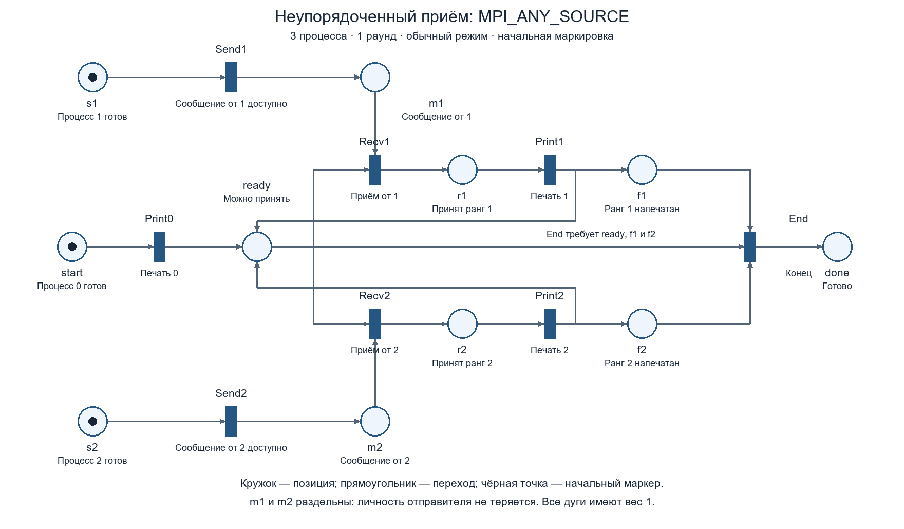
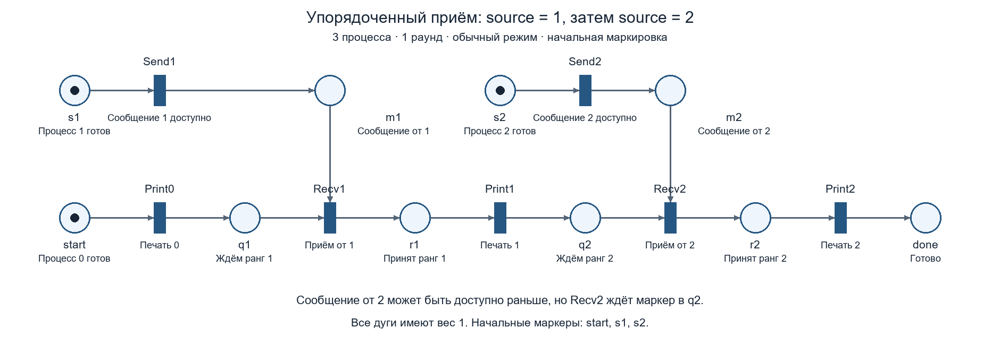

# Сети Петри для первой практической

Обе схемы описывают обычный запуск с **тремя процессами, одним раундом и одним целым числом в сообщении**: процесс 0 принимает ранги процессов 1 и 2. Это конечные обычные сети Петри с единичными весами дуг. Режим `--benchmark` не моделируется.

- [Произвольный приём, PNG](unordered.png), [SVG](unordered.svg).
- [Упорядоченный приём, PNG](ordered.png), [SVG](ordered.svg).

PNG удобно вставлять в Word. SVG сохраняет качество при увеличении. Чёрные точки на схемах показывают начальную маркировку.

## Границы модели

Моделируется логическая передача сообщения, его приём и порядок печати. `Send1` и `Send2` обозначают появление отдельного сообщения, доступного для соответствующего приёма. Они **не обозначают точный момент возврата из стандартного блокирующего `MPI_Send`**.

Внутренние протоколы MPI, буферы, начало и завершение вызовов отправки, `MPI_Init`, `MPI_Finalize` и физическое время скрыты. Стандартная отправка может завершиться до или после начала приёма; модель не делает о её возврате отдельного утверждения. Для анализа этих деталей потребовалось бы расширение сети состояниями незавершённых операций.

Позиции `m1` и `m2` — абстрактные факты наличия сообщений с известными отправителями, а не утверждение о двух физических буферах в MPI. Поскольку каждый отправитель посылает один раз, в каждой позиции бывает не больше одного маркера. Значение сообщения известно по ветви: в `m1` находится ранг 1, в `m2` — ранг 2. Цветные маркеры для этой фиксированной задачи не нужны.

`done` означает, что нулевой процесс напечатал все требуемые ранги; оно не утверждает, что все процессы уже вернулись из `MPI_Finalize`.

## Как читать сеть

- Кружок — позиция: условие или состояние.
- Прямоугольник — переход: действие.
- Чёрная точка — маркер.
- Все дуги имеют вес 1.
- Переход разрешён, если **во всех** его входных позициях есть маркеры.
- При срабатывании он забирает по маркеру из каждой входной позиции и добавляет по маркеру в каждую выходную.
- Пересечения линий без позиции или перехода не образуют дополнительного узла.

Начальная маркировка обеих сетей:

```text
M0 = {start, s1, s2}
```

В каждой из этих трёх позиций находится по одному маркеру, остальные пусты. Это означает готовность всех трёх процессов к действиям. `Send1`, `Send2` и `Print0` могут происходить в разном порядке: реальные отправители не обязаны ждать печати нуля. Приём же начинается только после `Print0`.

## Произвольный приём



Позиции:

| Позиция | Смысл |
|---|---|
| `start` | Процесс 0 ещё не напечатал свой ранг |
| `s1`, `s2` | Соответствующий отправитель ещё не опубликовал сообщение |
| `m1`, `m2` | Сообщение соответствующего отправителя доступно и ещё не принято |
| `ready` | Процесс 0 может выполнить следующий приём или закончить цикл |
| `r1`, `r2` | Принят соответствующий ранг, но он ещё не напечатан |
| `f1`, `f2` | Соответствующий ранг уже напечатан |
| `done` | Все требуемые строки напечатаны |

Переходы:

| Переход | Входные позиции | Выходные позиции |
|---|---|---|
| `Send1` | `s1` | `m1` |
| `Send2` | `s2` | `m2` |
| `Print0` | `start` | `ready` |
| `Recv1` | `ready`, `m1` | `r1` |
| `Print1` | `r1` | `ready`, `f1` |
| `Recv2` | `ready`, `m2` | `r2` |
| `Print2` | `r2` | `ready`, `f2` |
| `End` | `ready`, `f1`, `f2` | `done` |

Если доступны оба сообщения, одновременно разрешены `Recv1` и `Recv2`, но сработать первым может только один из них: они используют общий единственный маркер `ready`. Это выбор следующего сообщения при `MPI_ANY_SOURCE`.

После приёма маркера в `ready` нет. Сначала должна произойти печать принятого ранга; она возвращает маркер. Поэтому сеть не допускает два приёма подряд без промежуточной печати.

`f1` и `f2` сохраняют факты выполненной печати и позволяют проверить конец цикла. Это формальное представление условия завершения, а не дополнительные переменные в C++.

**Разветвление после Print — «И».** Например, `Print1` создаёт и разрешение продолжить (`ready`), и факт завершения печати (`f1`). Это не запуск двух процессов. Все входы `End` тоже работают как «И»: для завершения нужны оба напечатанных ранга и готовность получателя.

Пример последовательности с выводом `0, 2, 1`:

```text
Send1 → Send2 → Print0 → Recv2 → Print2 → Recv1 → Print1 → End
```

Маркировки для этой последовательности:

```text
{start, s1, s2}
{start, m1, s2}
{start, m1, m2}
{ready, m1, m2}
{r2, m1}
{ready, f2, m1}
{r1, f2}
{ready, f1, f2}
{done}
```

## Упорядоченный приём



Вместо общей позиции `ready` используются последовательные состояния `q1` и `q2`:

```text
start → Print0 → q1 → Recv1 → r1 → Print1 → q2 → Recv2 → r2 → Print2 → done
```

Дополнительно `Recv1` требует маркер в `m1`, а `Recv2` — в `m2`.

Даже если `m2` уже содержит сообщение, `Recv2` не разрешён до появления маркера в `q2`. Он появляется только после приёма и печати ранга 1. Поэтому допустимый порядок печати единственный: `0, 1, 2`.

Порядок самих отправок не фиксирован. Например, корректна последовательность:

```text
Send2 → Print0 → Send1 → Recv1 → Print1 → Recv2 → Print2
```

## Проверка

`generate.py` строит изображения и JSON-описания сетей, затем перебирает достижимые маркировки и последовательности печати. Переходы проверяются по обычному правилу разрешённости, без искусственного ограничения вместимости выходных позиций; попытка создать второй маркер была бы обнаружена как ошибка.

Результаты записаны в `verification.json`:

| Свойство | Произвольный приём | Упорядоченный приём |
|---|---|---|
| Достижимых маркировок | 20 | 14 |
| Максимум маркеров в позиции | 1 | 1 |
| Тупиков до штатного завершения | 0 | 0 |
| Из каждого состояния можно завершить работу | Да | Да |
| Возможные последовательности печати | `0,1,2`; `0,2,1` | `0,1,2` |

Терминальная маркировка `{done}` не имеет разрешённых переходов — это нормальное завершение. Проверка относится к данной абстракции трёх процессов и одного раунда, а не является формальным доказательством всей MPI-программы при любых параметрах.

Для повторной генерации нужен Python 3 и Pillow:

```text
python -m pip install pillow
python practical-01/diagrams/generate.py
```

## Другие числа процессов и раунды

Для одного раунда и большего `p` в произвольной версии добавляются отдельные `s_i`, `m_i`, `r_i`, `f_i` и переходы `Send_i`, `Recv_i`, `Print_i` для каждого ненулевого ранга. `End` требует все `f_i` и `ready`.

В упорядоченной версии добавляются звенья последовательной цепочки. При `p = 1` достаточно `start → Print0 → done`.

Для нескольких раундов нельзя просто вернуть маркер из `done` в `start`: нужно также учитывать новые отправки и теги сообщений, чтобы раунды не смешивались. Представленные рисунки намеренно описывают один раунд.
